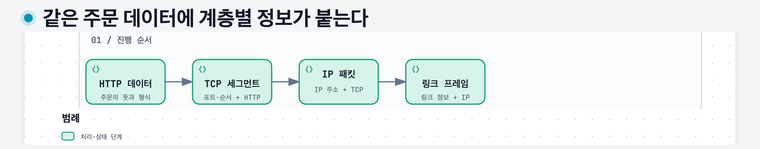
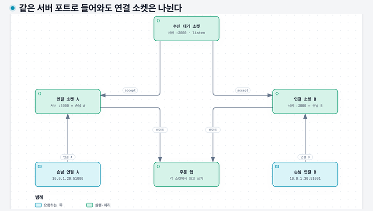

# 02. 다른 컴퓨터에 데이터를 보내기 — 패킷과 주소

## 이 장에서 배울 것

패킷을 나누는 이유와 계층별 정보의 역할을 설명한다. 소켓을 준비한 앱에 운영체제가 요청을 전달하는 과정, 여러 손님이 같은 서버 포트를 함께 사용할 수 있는 이유를 따라간다.

## 출발 상황과 선수 지식

[01장](01-computers-and-programs.md)에서 주문 프로그램을 컴퓨터 한 대에 실행했다. 이제 손님의 노트북에서 문구점 컴퓨터로 주문을 보내고 싶다. 두 컴퓨터가 어떤 방식으로 연결되고, 보낼 곳을 어떻게 구분하는지 알아보자.

## 1. 네트워크는 데이터를 주고받을 수 있게 연결한 것이다

노트북과 공유기를 Wi-Fi로 연결하거나 컴퓨터를 케이블로 연결하면, 그 연결을 통해 데이터를 보낼 수 있다. 이렇게 데이터를 교환할 수 있게 연결한 장치들의 구성을 **네트워크**라고 한다.

집 안의 연결과 문구점 안의 연결은 서로 다른 네트워크일 수 있다. 이 네트워크들을 다시 연결하면 더 먼 곳으로 데이터를 보낼 수 있다. 인터넷은 수많은 네트워크가 연결돼 데이터를 전달하는 체계다.

연결을 사용하는 데 필요한 물리 장치와 운영체제의 기능은 앱 아래에서 작동한다. 주문 앱은 “이 대상으로 데이터를 보내라”는 기능을 사용하고, 아래의 여러 장치와 소프트웨어가 실제 전달을 맡는다.

## 2. 한 번에 모든 데이터를 보내는 대신 나눈다

주문 정보가 작을 수도 있지만, 상품 사진이나 영상은 클 수 있다. 네트워크에서는 데이터를 전달 가능한 작은 단위로 나누어 보낸다. 이 교재에서는 IP 계층에서 전달하는 단위를 **패킷**이라고 부른다.

패킷에는 보내려는 데이터뿐 아니라 전달에 필요한 정보도 들어간다. 소포에 내용물과 주소표가 함께 있는 것처럼 생각할 수 있다. 실제 네트워크에서는 각 계층이 서로 다른 정보를 붙이지만 지금은 목적지 주소가 필요하다는 점부터 이해하자.

작게 나누면 다른 통신도 중간에 함께 전달할 수 있다. 대신 일부가 도착하지 않거나 도착 순서가 달라질 가능성도 다뤄야 한다. 그 문제를 해결하는 방법은 [04장](04-tcp-and-tls.md)에서 배운다.

### 작게 나누면 왜 여러 통신을 함께 처리하기 쉬울까

하나의 통신이 큰 파일 전체를 다 보낼 때까지 전송선을 독점한다고 가정하자. 그 뒤에 도착한 작은 주문 요청도 파일 전송이 끝날 때까지 기다려야 한다. 작은 단위로 나누면 전송 장치는 파일의 일부와 주문 패킷을 번갈아 보낼 수 있다. 단, 이렇게 나눈다고 자동으로 공정한 배분이나 지연 상한이 보장되는 것은 아니다.

패킷 크기에는 전달 경로의 제약도 있다. 한 링크에서 운반할 수 있는 최대 크기를 **MTU**라고 한다. 04장에서 배울 TCP는 이를 고려해 바이트를 나누어 IP에 넘긴다. 이때 TCP의 단위를 **세그먼트**, IP 패킷을 실제 링크에서 운반하는 단위를 **프레임**이라고 구분한다.

앱의 HTTP 데이터에 TCP의 포트·순서 정보가 붙고, 그 바깥에 IP의 주소 정보, 다시 링크 전송 정보가 붙는다. 이런 포장을 **캡슐화**라고 한다. 받는 쪽은 해당 계층의 정보를 해석해 안쪽 데이터를 다음 처리에 넘긴다. 목적지 IP만 있다고 HTTP의 주문 내용을 해석할 수는 없는 이유다.

같은 주문 데이터에 계층별 정보가 붙는다 — 송신 쪽의 포장 순서다. TCP 세그먼트는 IP 패킷의 안에, IP 패킷은 링크 프레임의 안에 담긴다. 수신 쪽은 바깥쪽부터 해석한다.

## 3. IP 주소 — 어느 네트워크 주소로 보낼 것인가

**IP**는 네트워크 사이에서 패킷을 전달하기 위한 규칙이다. **IP 주소**는 이 전달에 사용하는 주소다. 주소는 컴퓨터의 네트워크 연결 지점에 붙으며, 한 컴퓨터가 여러 연결과 주소를 가질 수도 있다.

우선 IPv4라는 주소 체계로 예를 들자. `10.0.1.10`처럼 점으로 구분한 네 숫자를 사용한다. 각 숫자는 0부터 255까지다. 실제로는 각 부분이 8비트이고 네 부분을 합쳐 32비트다. 01장에서 배운 8비트의 256가지 조합이 여기서 나온다.

이 숫자들을 주민등록번호처럼 영원히 고정된 기계의 이름으로 생각하면 안 된다. 연결한 네트워크나 배정 방식이 바뀌면 주소가 달라질 수 있다.

이 교재의 `10.0.1.10` 같은 주소는 내부 네트워크 예시다. 인터넷에서 직접 접속 가능한 예시에는 문서용 주소인 `203.0.113.10`을 사용한다. 실제로 이 주소에 접속해서 실습하는 것은 아니다.

## 4. 바로 연결되지 않았다면 누가 중간에 전달할까

집의 노트북과 문구점 컴퓨터가 직접 연결된 것은 아니다. 패킷은 중간 장치들을 거쳐 이동한다. **라우터**는 목적지 주소에 따라 패킷을 어느 방향으로 전달할지 고르는 장치다. 집의 공유기도 이런 역할을 맡는다.

노트북은 자기 네트워크 바깥으로 보낼 패킷을 다음 전달 장치에 넘긴다. 그 장치도 목적지에 따라 다음 곳으로 넘긴다. 여러 번의 전달을 거쳐 목적지 네트워크에 도착할 수 있다.

패킷마다 지나갈 전체 길이 출발점에서 하나로 고정돼 있어야 하는 것은 아니다. 각 전달 지점이 자기에게 필요한 다음 전달 결정을 한다. 상세한 경로 선택은 05장에서 다룬다.

## 5. 컴퓨터에 도착한 뒤 어느 프로그램에 줄까

문구점 컴퓨터에는 주문 프로그램과 관리자 프로그램이 함께 실행될 수 있다. 목적지 IP 주소만으로는 어느 프로그램에 보낼지 충분히 구분할 수 없다.

이때 사용하는 구분 값이 **포트 번호**다. 예를 들어 주문 프로그램은 3000번, 관리자 프로그램은 4000번 포트에서 통신을 기다리도록 실행할 수 있다. 같은 컴퓨터에 보내더라도 목적지 포트가 다르면 다른 통신 끝점을 선택한다.

**수신 대기(listen)**란 프로그램이 운영체제에 “이 주소와 포트로 오는 연결을 받겠다”고 준비하는 것이다. 앱 코드에 주문 기능이 있어도 수신 대기를 시작하지 않았다면 네트워크 요청을 받을 수 없다.

앱이 이런 네트워크 기능을 사용하도록 운영체제가 관리하는 통신 객체를 **소켓**이라고 한다. 앱은 소켓을 가리키는 참조로 읽기·쓰기 등을 요청한다. 소켓을 직접 만드는 프로그래밍은 이 교재의 선수 조건이 아니다.

**여기의 포트도 소켓도 소프트웨어 개념이다.** 포트 3000은 통신을 구분하는 번호이며, 랜선을 꽂는 물리 단자인 하드웨어 포트와 다르다. 물리 단자 하나로 받은 데이터도 운영체제가 주소·포트·연결 정보에 따라 여러 소켓으로 나누어 전달할 수 있다.

### 소켓은 어떻게 앱의 수신 통로가 될까

일반적인 TCP 서버에서 앱은 운영체제에 소켓 생성을 요청하고, 받을 로컬 주소와 포트를 지정한다. 이 지정을 **바인딩(bind)**이라고 한다. 그다음 `listen`으로 새 연결을 기다리도록 한다. 이 이름들은 앱이 운영체제에 요청하는 기능의 이름이다.

클라이언트가 연결을 시작하면 운영체제의 TCP 기능이 연결 절차를 수행한다. 연결이 성립한 것을 앱이 `accept`로 넘겨받으면, 특정 손님과 데이터를 주고받을 **새 연결 소켓**을 얻는다. 원래의 수신 소켓은 다음 손님도 받도록 남아 있다.

들어온 데이터를 어느 소켓으로 보낼지 고르는 주체는 우선 운영체제다. 그 소켓을 통해 바이트를 읽은 뒤 HTTP와 주문의 뜻을 해석하는 주체가 앱이다. 네트워크 데이터가 도착했다고 CPU가 곧바로 주문 함수부터 실행하는 구조로 생각하지 않는다.

## 6. 한 번의 연결에는 양쪽 주소가 있다

손님의 프로그램이 연결을 시작하면 손님 쪽에도 통신을 구분할 포트가 필요하다. 운영체제는 사용할 출발지 포트를 골라 줄 수 있다.

아래는 내부 네트워크에서의 가상 연결이다. 51000은 설명용 출발지 포트이며 고정 규칙이 아니다.

| 쪽 | IP 주소 | 포트 | 역할 |
|---|---|---|---|
| 손님 컴퓨터 | `10.0.1.20` | 51000 | 연결을 시작한다 |
| 주문 컴퓨터 | `10.0.1.10` | 3000 | 연결을 기다린다 |

주문 결과를 보낼 때는 손님 쪽 연결로 응답한다. 그래서 요청과 응답의 출발지·목적지 역할이 바뀐다. 방화벽을 배울 때 이 왕복 관계가 중요해진다.

### 손님 둘이 같은 3000번에 연결해도 왜 섞이지 않을까

TCP 연결은 출발지 IP·포트와 목적지 IP·포트의 조합으로 구분한다. 손님 둘이 같은 서버의 3000번에 연결해도 손님 쪽 주소나 포트가 다르면 서로 다른 연결이다. 서버가 손님마다 새로운 수신 포트를 만들 필요는 없다.

예를 들어 같은 손님 컴퓨터가 `10.0.1.20:51000`과 `10.0.1.20:51001`에서 `10.0.1.10:3000`으로 연결하면, 서버 포트는 같아도 두 연결을 구분할 수 있다. 프로토콜까지 포함해 TCP와 UDP 통신을 구분하는 관점도 있다. UDP는 TCP처럼 연결 설정과 순서·재전송을 기본 제공하지 않는 별도의 전송 프로토콜이다.

이 조합은 한 구간에서 보는 주소다. NAT나 프록시가 중간에 있으면 다른 구간에서는 주소 조합이 바뀔 수 있다. 그래서 요청을 추적할 때 클라이언트가 본 연결과 서버가 본 연결을 무조건 같은 값으로 맞추지 않는다.

같은 서버 포트로 들어와도 연결 소켓은 나뉜다 — 수신 대기 소켓은 새 연결을 받는 입구이고, 앱은 accept로 얻은 연결 소켓에서 읽고 쓴다. 포트 3000은 소프트웨어의 번호이며 랜선 단자가 아니다.

## 7. 내 컴퓨터 안에서만 시험하기

다른 컴퓨터 없이 앱과 통신할 때는 **루프백 주소** `127.0.0.1`을 사용할 수 있다. “지금 내가 속한 이 네트워크 환경의 자기 자신”으로 보내는 주소다. `localhost`라는 이름도 보통 루프백 주소를 가리키도록 설정된다.

주문 앱이 `127.0.0.1:3000`에서만 기다리면 같은 컴퓨터 안에서는 접속해도 다른 컴퓨터에서 직접 그 수신 끝점에 연결할 수 없다. 자기 자신에게 보내는 주소를 외부 컴퓨터의 주소로 사용할 수는 없기 때문이다.

앱을 `0.0.0.0`에 바인딩한다는 것은 IPv4의 모든 로컬 네트워크 인터페이스에서 수신하겠다는 뜻이다. 이 값은 사용자가 접속할 실제 목적지 IP를 알려 주는 것이 아니다. 경로와 통신 허용까지 자동으로 만들어 주지도 않는다.

## 주문 요청에 대입하기

손님 프로그램은 주문 컴퓨터의 주소와 포트로 연결한다. 패킷은 네트워크 장치들을 거쳐 전달되고, 도착한 운영체제는 해당 통신을 주문 프로세스에 연결한다. 그 뒤 주문 앱이 데이터의 의미를 읽는다.

여기까지는 “어디로 보내고 어느 프로그램이 받을까”를 배웠다. 무엇을 주문한다는 뜻인지 표현하는 규칙은 다음 장에서 배운다.

## 꼭 기억할 것

- **카드 03:** IP 주소는 네트워크에서 보낼 주소를, 포트는 그 주소의 통신 끝점을 구분한다. 앱은 수신 대기를 시작해야 연결을 받을 수 있다.

## 자가 진단

답을 먼저 적은 뒤 접힌 해설을 연다. 이어 [워크북](../workbook/92-workbook.md)의 1-3, 2-1번으로 확인한다. 막히면 [단계별 힌트](../workbook/94-hints.md), 답을 쓴 뒤에는 [필수 기준·오개념별 복습](../workbook/93-solutions.md)을 사용한다.

문구점 컴퓨터에 주문 앱과 관리자 앱이 함께 있다. 목적지 IP만 같으면 같은 앱이 받을까?

그렇지 않다. 서로 다른 포트에 수신 대기하면 같은 IP에서도 다른 통신 끝점으로 연결된다.

앱이 localhost에서 잘 되는데 친구의 컴퓨터에서는 접속되지 않는다. 어떤 차이를 먼저 생각할까?

루프백에만 수신 대기하는지 확인한다. 루프백은 자기 자신을 위한 주소다. 외부 접속에는 실제 주소·수신 설정·경로·허용 조건이 필요하다.

주문 프로그램이 연결을 기다리는 포트와 손님이 연결을 시작할 때 쓰는 포트는 같아야 할까?

같을 필요는 없다. 양쪽은 각자의 통신 끝점을 사용한다. 응답도 그 연결 관계에 따라 돌아간다.

손님 100명이 서버의 같은 3000번 포트로 접속하면 한 명만 연결할 수 있을까?

아니다. 운영체제는 양쪽 IP와 포트의 조합으로 연결을 구분하고, 앱은 각 연결 소켓을 통해 데이터를 읽는다. 수신 포트 하나라는 사실이 동시 연결 하나라는 뜻은 아니다. 실제 수용량은 자원과 설정에 달려 있다.

## 근거와 다음 장

주소와 통신의 입문 설명은 [MDN](https://developer.mozilla.org/en-US/docs/Learn_web_development/Getting_started/Web_standards/How_the_web_works), 소켓은 [Linux 매뉴얼](https://man7.org/linux/man-pages/man7/socket.7.html), 연결 구분과 수신 절차는 [tcp(7)](https://man7.org/linux/man-pages/man7/tcp.7.html)을 참고했다. 다음은 [이름과 HTTP 요청](03-dns-and-http.md)이다.
