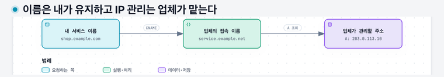
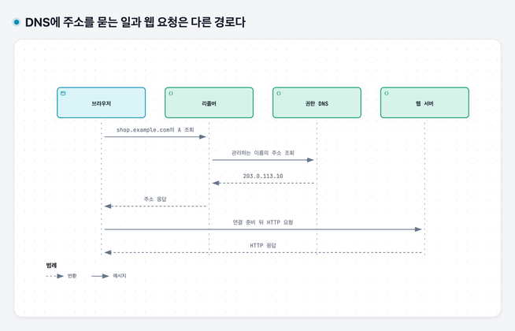
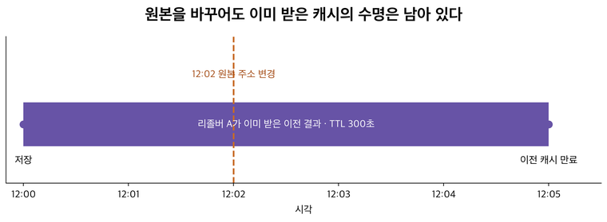

# 03. 이름으로 찾아가고 요청의 뜻을 전달하기 — DNS와 HTTP

## 이 장에서 배울 것

DNS가 이름 관리 책임을 나누는 방식과 조회·캐시의 순서를 설명한다. HTTP 메시지를 읽고 요청의 뜻, 메시지 경계, 상태 코드가 각각 어떤 문제를 해결하는지 구분한다.

## 출발 상황과 선수 지식

[02장](02-addresses-and-packets.md)에서 IP 주소와 포트로 통신 대상을 구분했다. 그런데 사용자가 주문 서버의 숫자 주소를 외우기는 어렵다. 또 서버에 도착한 데이터가 상품 조회인지 주문 생성인지도 구분해야 한다. 이 두 문제를 차례로 풀어 보자.

## 1. 이름과 주소를 분리하면 무엇이 좋아질까

가상의 문구점 주소를 `shop.example.com`이라고 하자. 사람은 이 이름을 기억하고 사용한다. 문구점이 다른 컴퓨터로 옮겨도 사람이 사용하는 이름은 유지하고, 그 이름이 가리키는 주소 정보를 바꿀 수 있다.

**도메인 이름**은 이런 계층적인 이름이다. **DNS**는 이름에 대응하는 IP 주소 등의 정보를 찾는 분산된 체계다. DNS의 답을 얻은 뒤 실제 데이터를 보내는 일은 별도로 진행한다. 주소록에서 전화번호를 찾는 것과 전화를 거는 것이 다른 것과 비슷하다.

## 2. DNS 조회를 한 번 따라가기

새로 이름을 조회하는 기본 흐름은 다음과 같다. 실제로는 이미 저장된 결과를 재사용할 수 있다.

1. 손님의 프로그램이 `shop.example.com`의 주소가 필요하다고 요청한다.
2. 컴퓨터가 사용하는 DNS 조회 서버가 답을 찾는다. 이 서버를 **리졸버**라고 부른다.
3. 답이 저장돼 있지 않으면 리졸버는 DNS의 여러 서버에 물어 해당 이름을 관리하는 서버를 찾는다.
4. 이름을 관리하는 서버의 정보를 바탕으로 주소 결과를 돌려받는다.
5. 손님의 프로그램은 얻은 주소로 주문 서버에 연결한다.

이름의 어떤 정보를 묻는지도 지정한다. **A 레코드**는 IPv4 주소, **AAAA 레코드**는 IPv6 주소를 나타낸다. IPv6는 IPv4와 다른 주소 체계다. **CNAME 레코드**는 어떤 이름을 다른 이름의 **별칭**으로 연결한다. 주소를 직접 적는 것과 별칭을 만드는 것은 왜 다를까?

### CNAME은 왜 쓸까 — 내 서비스 이름과 업체의 주소 관리를 분리하기

문구점 앱을 외부 호스팅 업체에 올렸다고 하자. 업체는 접속 이름 `service.example.net`을 제공하고 그 이름의 IP 주소를 관리한다. 손님에게는 업체 이름 대신 내 이름인 `shop.example.com`을 쓰게 하고 싶다. 아래 이름과 IP는 실제 서비스가 아닌 설명용 값이다.

| 내 DNS에 등록하는 방식 | 업체가 IP를 바꾸면 누가 무엇을 바꿔야 할까? |
|---|---|
| `shop.example.com`의 A 값에 업체의 현재 IP를 복사한다 | 업체의 변경을 내가 알아내 내 A 값도 수정해야 한다 |
| `shop.example.com`의 CNAME 값에 `service.example.net`을 적는다 | 업체는 자기 이름의 주소를 변경한다. 업체가 그 접속 이름을 유지하면 내 CNAME은 그대로 둔다 |

즉, CNAME은 **내가 유지할 서비스 이름과 다른 쪽에서 관리하는 접속 대상을 연결**할 때 쓴다. IP를 직접 관리하는 서버 하나에 이름 하나를 붙이는 상황이라면 A 레코드로 충분할 수도 있다. CNAME을 쓴다고 서버가 더 생기거나 요청 처리 속도가 빨라지는 것은 아니다.

다음은 TTL 등의 필드를 생략한 설명용 레코드다. 왼쪽은 조회할 이름, 가운데는 종류, 오른쪽은 값이다.

```text
shop.example.com       CNAME   service.example.net
service.example.net    A       203.0.113.10
```

1. 브라우저가 `shop.example.com`의 주소를 요청한다.
2. 리졸버는 CNAME을 보고 주소를 찾을 이름을 `service.example.net`으로 바꿔 따라간다.
3. 그 이름의 A 결과 `203.0.113.10`을 얻는다. 필요한 답이 응답이나 캐시에 있으면 활용하고, 없으면 추가 조회한다.
4. 브라우저는 얻은 IP로 연결한다. DNS 서버가 웹 요청을 대신 전달하는 것은 아니다.

업체가 A 값을 `203.0.113.20`으로 바꾸면, 이전 주소의 캐시가 만료되고 새 결과를 얻은 클라이언트는 새 IP로 연결할 수 있다. 내 CNAME 값은 여전히 `service.example.net`이다. 반대로 업체가 **접속 이름 자체를 폐기**하면 내 연결도 고쳐야 한다. CNAME과 대상 A는 각각 캐시되므로 변경이 즉시 모든 사용자에게 반영되는 것도 아니다.

**다른 이름을 따라 주소를 찾는 것과 웹 주소를 바꾸는 것은 다르다.** 위 예에서 주소창과 HTTP 요청의 대상 이름은 `shop.example.com`으로 유지된다. 호스팅 업체에도 이 이름을 내 앱에 연결하는 설정이 필요하고, HTTPS 인증서도 이 이름에 맞아야 한다. CNAME만 등록한다고 웹 서비스 설정까지 자동으로 완료되지는 않는다.

표준 CNAME은 `shop.example.com` 같은 별칭에 쓰며, DNS 영역의 맨 위 이름인 `example.com`에는 그대로 둘 수 없다. 그 자리에는 영역 관리에 필요한 다른 레코드가 있기 때문이다. Route 53의 **Alias** 같은 공급자 기능은 별도로 구분한다. [CNAME의 조회 규칙](https://www.rfc-editor.org/rfc/rfc1034#section-3.6.2)과 [Route 53의 CNAME·Alias 구분](https://docs.aws.amazon.com/Route53/latest/DeveloperGuide/ResourceRecordTypes.html#CNAMEFormat)을 참고했다.

[](assets/diagrams/03-cname.png)

이름은 내가 유지하고 IP 관리는 업체가 맡는다 — 가로 화살표는 웹 트래픽이 아니라 DNS의 이름 해석 관계다. 업체가 접속 이름을 유지하면 대상 IP가 바뀌어도 내 CNAME은 유지할 수 있다. 캐시 만료는 별도다.

### 리졸버는 어느 서버에 물어볼지 어떻게 알까

전 세계의 모든 이름을 한 서버가 직접 관리하면 변경 요청과 조회가 한곳에 몰린다. DNS는 이름을 계층으로 나누고, 각 부분의 관리 책임을 다른 서버에 맡긴다. 책임을 넘기는 것을 **위임**이라고 한다. 이름을 직접 관리하며 그 영역의 공식 답을 제공하는 서버가 **권한 있는 서버(authoritative server)**다.

캐시가 전혀 없는 설명용 사례에서 재귀 리졸버는 먼저 루트 서버에 묻는다. 루트는 문구점의 IP 대신 `.com` 영역을 담당하는 서버의 정보를 알려 준다. `.com` 서버는 `example.com` 영역을 담당하는 서버로 안내하고, 그 영역의 서버가 `shop.example.com`의 레코드를 답할 수 있다.

여기서 **재귀**는 클라이언트가 리졸버에게 최종 답을 구해 달라고 맡기는 방식이다. 리졸버가 여러 서버에서 안내를 받아 다음 곳에 묻는 과정과 구분한다. 실제 조회에서는 중간 안내도 캐시하므로 매번 루트부터 방문하지 않는다. 루트 서버가 사용자의 HTTP 요청을 문구점까지 전달해 주는 것도 아니다.

[](assets/diagrams/03-dns-http.png)

DNS에 주소를 묻는 일과 웹 요청은 다른 경로다 — 위에서 아래로 시간 순서다. 캐시가 없는 단순화한 사례이며, DNS는 주소를 알려 주고 HTTP 요청은 웹 서버로 간다.

## 3. 이름을 바꿨는데 왜 바로 반영되지 않을까

같은 주소를 찾을 때마다 모든 DNS 서버에 다시 물으면 비용이 든다. 그래서 조회 결과를 일정 시간 저장해 재사용한다. 이렇게 재사용하는 저장을 **캐시**라고 한다.

DNS 결과의 **TTL**은 그 결과를 캐시에 유지할 수 있는 시간을 나타낸다. 서버 주소를 바꾸어도 어떤 이용자는 이전 결과를 캐시에 갖고 있을 수 있다. 모든 이용자가 한 순간에 새 주소를 쓰기 시작한다고 기대할 수 없는 이유다.

예를 들어 리졸버 A는 변경 직전 답을 저장했고, 리졸버 B는 변경 직후 처음 조회했다고 하자. 같은 이름을 조회해도 일정 시간 서로 다른 결과를 줄 수 있다. 사용자에게 받은 시각과 실제 접속 대상을 함께 기록하면 이런 차이를 확인하는 데 도움이 된다.

### TTL을 시간으로 계산해 보기

설명용으로 이전 주소의 TTL이 300초라고 하자. 리졸버 A가 12:00에 답을 받아 저장한 뒤, 관리자가 12:02에 원본 주소를 바꾸었다. A는 보관 중인 답이 유효한 동안 12:05까지 이전 주소를 돌려줄 수 있다. 새로 조회하는 다른 리졸버는 그보다 먼저 새 주소를 볼 수 있다.

변경 직전에 원본 TTL을 30초로 줄여도 A가 이미 받은 300초가 소급해 30초로 바뀌지는 않는다. 그래서 전환을 계획한다면 기존 캐시 수명을 먼저 고려해야 한다. TTL은 DNS 응답의 캐시 수명이며, 이미 맺은 TCP 연결을 끊는 타이머도 아니다.

[](assets/diagrams/03-ttl.png)

DNS 변경 시각과 캐시 만료 시각은 다르다 — 본문의 TTL 300초 예다. 12:02에 원본을 고쳐도 A가 12:00에 받은 결과는 12:05까지 유효할 수 있다. 기존 TCP 연결의 수명은 이 막대로 표현하지 않았다.

## 4. 요청의 뜻을 서로 약속해야 한다

주소와 포트로 주문 앱에 도착해도, 데이터가 `7` 하나뿐이면 해석이 모호하다. 상품 번호 7을 조회하라는 뜻인지, 일곱 개를 주문하라는 뜻인지 알 수 없다.

**프로토콜**은 이렇게 통신할 때 지킬 형식과 동작의 약속이다. **HTTP**는 요청과 응답을 주고받는 애플리케이션 수준의 프로토콜이다. 웹 브라우저와 웹 서버가 널리 사용하며, 프로그램끼리 기능과 데이터를 요청할 접점을 정하는 **API**에도 사용한다. API는 요청·결과를 주고받을 약속이고 HTTP는 그 약속을 실현할 통신 방식 중 하나다.

**클라이언트**는 요청을 보내는 쪽, **서버**는 요청을 받아 응답하는 쪽의 역할이다. 서버라는 말은 그 역할을 하는 프로그램이나 그 프로그램이 실행되는 컴퓨터를 가리킬 때도 있다. 이 교재에서는 문맥에 따라 “서버 프로그램”과 “서버 컴퓨터”로 구분한다.

## 5. URL을 읽어 보기

`https://shop.example.com/products/7`을 나누면 다음처럼 읽을 수 있다.

| 부분 | 뜻 |
|---|---|
| `https` | TLS로 보호하는 HTTP 통신을 사용한다 |
| `shop.example.com` | 접속 대상을 찾을 이름이다 |
| `/products/7` | 서버에서 요청할 대상의 경로다 |

포트가 생략되면 사용하는 방식에 정해진 기본 포트를 따른다. HTTP는 80, HTTPS는 443이 기본이다. `http://127.0.0.1:3000/products/7`처럼 다른 포트를 명시할 수도 있다. HTTPS의 보호가 어떻게 작동하는지는 다음 장에서 설명한다.

## 6. HTTP 메시지를 읽어 보기

다음은 HTTP/1.1 요청의 형식을 읽기 위한 예다.

```http
GET /products/7 HTTP/1.1
Host: shop.example.com
Accept: text/plain

```

첫 줄의 `GET`은 정보를 읽겠다는 **메서드**다. `/products/7`은 대상 경로다. `Host`와 `Accept` 같은 항목은 요청에 관한 추가 정보인 **헤더**다. 헤더 다음의 빈 줄은 헤더와 그 뒤의 내용을 구분한다.

서버는 다음과 같은 형식으로 응답할 수 있다.

```http
HTTP/1.1 200 OK
Content-Type: text/plain
Content-Length: 7

stock=1
```

`200`은 요청이 성공했다는 HTTP 상태 코드다. `Content-Type`은 뒤의 내용이 일반 텍스트임을, `Content-Length`는 본문이 7바이트임을 나타낸다. 여기서 본문은 줄바꿈을 제외한 `stock=1`이다. 본문은 실제 전달할 데이터다.

주문 생성처럼 서버의 상태를 바꾸려면 `POST /orders` 같은 요청을 설계할 수 있다. 상품 번호와 수량은 본문으로 보낸다. 정확한 경로와 데이터 모양은 그 API의 계약이다. HTTP가 모든 쇼핑몰의 업무 규칙을 정해 주는 것은 아니다.

### 헤더와 길이가 없으면 어디서 응답이 끝나는지 어떻게 알까

TCP는 바이트 흐름을 주므로 한 번 읽었다고 메시지 전체가 온 것은 아니다. HTTP 처리기는 먼저 첫 줄과 헤더를 읽고, 빈 줄 뒤의 본문을 어떤 규칙으로 읽을지 결정한다. 예시의 `Content-Length: 7`은 본문 7바이트를 읽어야 한다는 정보다. 본문이 여러 번에 나누어 도착해도 그 길이까지 모아 해석한다.

길이를 미리 모르는 경우에 사용하는 별도 전달 방식도 있다. 여기서 배울 핵심은 **전달된 바이트 수와 완성된 메시지의 경계가 별개**라는 것이다. 연결 하나에서 여러 HTTP 요청·응답을 주고받으려면 이 경계를 정확히 알아야 한다.

### 상태 코드는 누가 어느 단계에서 답한 것일까

`2xx`는 성공, `4xx`는 요청 쪽 문제, `5xx`는 서버 쪽 오류를 나타내는 상태 코드 묶음이다. 예를 들어 `404`는 요청한 대상을 찾지 못한 경우, `503`은 일시적으로 요청을 처리할 수 없는 경우에 사용할 수 있다. 구체적인 원인은 응답을 만든 처리자의 기록으로 확인해야 한다.

메서드에도 의미가 있다. `GET`은 대상의 표현을 가져오며, `POST`는 전달한 내용을 대상의 규칙에 따라 처리하도록 요청한다. 주문 생성에 POST를 썼다고 중복 주문 방지가 자동 제공되지는 않는다. 또 `202 Accepted`는 처리를 접수했다는 뜻이므로 업무가 이미 완료됐다는 뜻으로 읽으면 안 된다. 11·12장에서 재시도와 나중에 완료하는 작업으로 연결한다.

## 7. 이름 찾기와 HTTP 요청은 다른 사건이다

DNS 서버는 주문 결과를 주지 않는다. 접속에 필요한 정보를 알려 준다. 주문 서버 프로그램이 HTTP 요청을 읽고 업무를 수행한 뒤 응답한다.

이름을 못 찾으면 HTTP 요청을 보낼 주소를 얻지 못할 수 있다. 반대로 `404` 같은 HTTP 응답을 받았다면 어떤 HTTP 처리자가 답한 것이다. 단, 중간 서버가 답했거나 다른 앱에 접속했을 수도 있어 원하는 앱의 응답인지는 확인해야 한다.

## 짧은 관찰

터미널은 명령을 글자로 입력하는 도구다. macOS나 Linux에서 `curl -i https://example.com/`을 실행하면 공개 예시 사이트의 응답 헤더와 본문을 볼 수 있다. 이때 명령을 보내는 `curl`이 클라이언트다.

특정 상태 코드나 본문을 외우는 실습이 아니다. 상태 줄, 헤더, 본문을 실제 출력에서 구분해 본다. 실행 환경의 네트워크 정책 때문에 실패하면 그 사실을 기록한다.

## 꼭 기억할 것

- **카드 04:** DNS는 이름에 대응하는 정보를 찾고, HTTP는 요청과 응답의 형식·의미를 정한다. 주소를 찾은 것과 업무를 처리한 것은 다르다.

## 자가 진단

답을 먼저 적은 뒤 접힌 해설을 연다. 이어 [워크북](../workbook/92-workbook.md)의 1-4, 3-1번으로 확인한다. 막히면 [단계별 힌트](../workbook/94-hints.md), 답을 쓴 뒤에는 [필수 기준·오개념별 복습](../workbook/93-solutions.md)을 사용한다.

<details><summary>주문 서버의 IP가 바뀌면 손님이 쓰는 도메인도 반드시 바꿔야 할까?</summary>

이름은 유지하고 DNS의 주소 정보를 바꿀 수 있다. 단, 이전 결과가 캐시에 남아 모두가 즉시 새 주소를 쓰지는 않을 수 있다.
</details>

<details><summary>GET과 /products/7은 각각 무엇을 나타낼까?</summary>

GET은 읽기 요청의 메서드이고, 경로는 요청 대상을 나타낸다. 헤더와 본문은 이와 다른 부분이다.
</details>

<details><summary>DNS가 주문을 처리하지 않는다면 DNS 조회 뒤에 무엇이 더 필요할까?</summary>

찾은 주소와 포트에 연결하고, 서버 프로그램에 요청을 보내고, 처리 결과의 응답을 받아야 한다.
</details>

<details><summary>DNS 원본을 바꾼 직후에도 이전 서버에 요청이 갈 수 있는 이유를 두 가지 설명해 보자.</summary>

리졸버나 클라이언트에 이전 DNS 결과가 유효한 캐시로 남아 있을 수 있다. 이미 이전 주소로 맺은 연결을 재사용하는 경우도 있다. DNS 변경이 모든 캐시와 기존 연결을 즉시 교체하는 것은 아니다.
</details>

## 근거와 다음 장

[DNS 표준](https://www.rfc-editor.org/rfc/rfc1034)과 [HTTP 메시지 설명](https://developer.mozilla.org/en-US/docs/Web/HTTP/Guides/Messages), [HTTP 의미 표준](https://www.rfc-editor.org/rfc/rfc9110)을 참고했다. 다음 [04장](04-tcp-and-tls.md)에서 데이터 전달과 HTTPS의 보호를 배운다.
