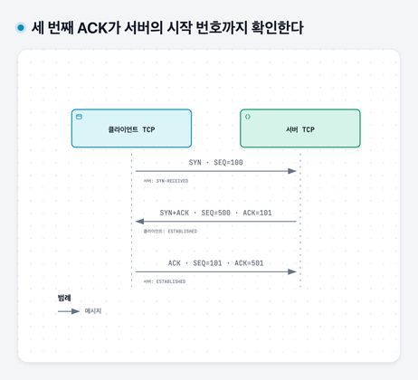
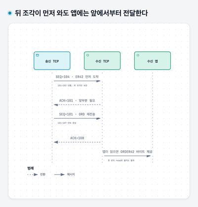
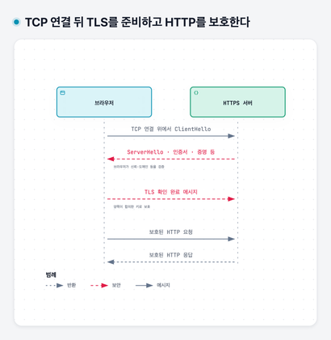

# 04. 도착했는지 확인하고 내용을 보호하기 — TCP와 TLS

## 이 장에서 배울 것

TCP 연결이 기억하는 정보와 3-way handshake의 각 메시지를 설명한다. 데이터 누락·중복·순서 변경을 처리하는 과정을 번호로 따라간다. 그 위에서 TLS가 키 교환과 상대 인증을 별도로 수행해야 하는 이유를 이해한다.

## 출발 상황과 선수 지식

[02장](02-addresses-and-packets.md)의 패킷·소켓·포트와 [03장](03-dns-and-http.md)의 HTTP 메시지를 사용한다. IP로 데이터를 보냈다는 사실만으로 도착·순서·비밀이 보장되지는 않는다. 손님의 주문을 제대로 읽으려면 무엇을 더 약속해야 할까?

이 장의 기본 사례는 **HTTP/1.1을 TCP 위에서 TLS로 보호하는 HTTPS**다. HTTP/3는 QUIC을 사용하므로 모든 HTTPS가 같은 TCP 절차를 따른다고 일반화하지 않는다. 시간·주소·작은 순서 번호는 설명용 가정이다.

## 1. TCP는 앱에 무엇을 제공할까

**TCP**는 양방향으로 순서 있는 바이트 흐름을 제공하는 전송 프로토콜이다. 앱이 보낸 `ORDER42`가 여러 세그먼트로 나뉘거나 순서가 뒤바뀌어 도착해도, 받는 앱에는 원래 순서의 바이트를 읽게 한다. 누락된 앞부분을 복구할 때까지 뒤의 데이터 전달이 기다릴 수 있다.

이 기능은 일반적인 운영체제의 **TCP 스택**, 즉 TCP 규칙을 구현한 커널의 기능이 수행한다. 앱은 소켓으로 읽고 쓰며, 보통 SYN 패킷이나 재전송을 직접 구현하지 않는다. 앱이 운영체제에 쓰기를 요청한 것과 상대 앱이 업무 처리를 끝낸 것도 구분해야 한다.

TCP는 메시지 단위를 보존하지 않는다. 앱이 `ORD`와 `ER42`를 두 번 써도 상대는 `ORDER42`를 한 번에 읽거나 더 잘게 읽을 수 있다. 따라서 HTTP가 헤더·본문 길이로 메시지 경계를 정하는 것이다. 네트워크가 계속 끊기면 재전송으로도 전달하지 못하고 연결이 실패할 수 있다.

## 2. 연결은 전용 선이 아니라 양쪽이 유지하는 상태다

**TCP 연결**을 맺는다고 두 컴퓨터 사이에 전용 케이블이 생기는 것은 아니다. 패킷은 여전히 공유 네트워크를 통과한다. 대신 양쪽이 이 통신에 관한 정보를 기억한다.

| 기억할 정보 | 필요한 이유 |
|---|---|
| 양쪽 IP와 포트 | 어느 소켓 사이의 통신인지 구분한다 |
| 다음에 보낼 순서 번호 | 보낼 바이트의 위치를 표시한다 |
| 다음에 받을 것으로 기대하는 번호 | 빠진 부분과 연속 수신 범위를 구분한다 |
| 보냈지만 확인받지 못한 데이터 | 필요하면 다시 보낸다 |
| 받은 데이터를 잠시 둘 공간 | 앱이 읽기 전까지 보관한다 |
| 연결 상태와 타이머 | 연결 시작·종료와 응답 대기를 처리한다 |

이렇게 데이터를 잠시 두는 공간을 **버퍼**라고 한다. 연결이 늘면 각 연결의 상태와 버퍼도 자원을 사용한다. 같은 HTTP 주소로 접속하더라도 새 TCP 연결을 만드는 경우와 기존 연결을 재사용하는 경우의 준비 비용이 다른 이유다.

## 3. 순서 번호는 패킷 번호가 아니라 바이트 위치다

**SEQ(sequence number)**는 이 세그먼트 데이터가 바이트 흐름의 어느 위치에서 시작하는지 나타낸다. 데이터가 3바이트면 다음 데이터의 시작 번호는 3만큼 진행한다. 패킷을 하나 보낼 때마다 무조건 1씩 늘어나는 번호가 아니다.

**ACK 번호(acknowledgment number)**는 기본적인 누적 확인에서 “이 번호 직전까지 연속으로 받았으며, 다음에는 이 번호의 바이트를 기대한다”는 뜻이다. ACK 플래그는 헤더의 ACK 번호를 유효한 확인 정보로 해석하라는 표시다. 플래그는 헤더에 켜고 끄는 제어 비트다.

TCP는 양방향이므로 클라이언트가 보낼 번호와 서버가 보낼 번호가 각각 필요하다. 두 방향이 하나의 공통 번호를 번갈아 쓰는 구조가 아니다. 연결 시작 때 각자가 고르는 첫 번호를 **초기 순서 번호(ISN)**라고 한다.

## 4. 왜 연결 시작에 세 번의 교환이 필요할까

서버 앱은 먼저 주소·포트를 바인딩하고 `listen`으로 기다린다. 클라이언트 앱이 `connect`로 연결을 요청하면 양쪽 TCP가 연결 절차를 수행한다. 서버는 처음 온 요청만으로 상대가 자기 응답까지 받았다고 알 수 없다. 새 통신의 번호도 양방향으로 맞춰야 한다.

**SYN**은 연결 시작에 순서 번호를 동기화하는 제어 플래그다. 클라이언트 ISN이 100, 서버 ISN이 500이라고 가정하자. 아래의 상태는 각 메시지를 처리한 직후를 나타낸다. 데이터는 아직 싣지 않는 기본 사례다.

| 순서와 방향 | 헤더의 핵심 값 | 받는 쪽이 새로 아는 것 | 상태 변화 |
|---|---|---|---|
| 1. 클라이언트 → 서버 | SYN, SEQ=100 | 클라이언트가 100에서 시작하려 한다 | 클라이언트 SYN-SENT, 서버 SYN-RECEIVED |
| 2. 서버 → 클라이언트 | SYN+ACK, SEQ=500, ACK=101 | 내 SYN을 받았고 서버는 500에서 시작한다 | 클라이언트 ESTABLISHED, 서버는 아직 대기 |
| 3. 클라이언트 → 서버 | ACK, SEQ=101, ACK=501 | 클라이언트가 서버의 SYN까지 받았다 | 서버도 ESTABLISHED |

`SYN-SENT`는 시작 요청을 보냈다는 상태, `SYN-RECEIVED`는 상대 요청을 받아 응답하고 확인을 기다리는 상태, `ESTABLISHED`는 연결이 성립한 상태다. 서버의 수신 대기 소켓은 계속 LISTEN 상태로 다른 손님을 받는다.

**SYN은 데이터가 없어도 순서 번호 한 칸을 사용한다.** 연결 시작 정보도 유실·중복될 수 있으므로 번호를 사용해 확인·재전송할 제어 정보로 다루는 것이다. 실제 앱 데이터 1바이트를 보냈다는 뜻은 아니다. 그래서 첫 SYN의 확인은 101이고 첫 실제 데이터도 101부터 시작한다. 서버도 마찬가지로 501부터 데이터를 보낸다. 데이터도 SYN도 FIN도 없는 순수 ACK는 순서 번호를 소비하지 않아, 세 번째 메시지를 보냈다고 첫 데이터가 102부터 시작하지 않는다.

두 번째 메시지는 클라이언트의 시작 번호를 확인하면서 서버의 시작 번호를 함께 알린다. 세 번째 메시지는 그 서버 번호를 받았다는 확인을 돌려준다. 별도로 하면 네 번인 두 방향의 알림·확인을 한 메시지에 합쳐 기본 세 번이 된다.

세 번째 ACK가 서버의 시작 번호까지 확인한다 — 데이터를 싣지 않은 기본 예다. 클라이언트는 두 번째 메시지 뒤 연결됨 상태지만 서버는 세 번째 확인을 기다린다. 수신 대기 소켓은 별도로 남는다.

### 두 번째에서 바로 끝내면 왜 부족할까

서버가 SYN+ACK를 보내기만 하고 연결을 확정하면, 클라이언트가 서버의 시작 정보를 받았는지 확인할 수 없다. 오래전에 보냈던 SYN 복사본이 늦게 도착한 경우에도 현재의 연결 요청으로 오해할 수 있다.

새 서버 번호를 확인하는 마지막 ACK를 요구하면, 늦은 SYN 하나만으로 서버가 정상 연결을 확정하지 않는다. 현재 클라이언트가 없는 경우에는 유효한 확인이 돌아오지 않거나 거절 응답이 온다. **오래된 연결 시작을 새 연결로 혼동하지 않는 것**은 표준이 설명하는 중요한 설계 이유다. 단순히 “둘 다 켜져 있는지 세 번 확인”하는 절차가 아니다.

세 번째 ACK가 유실되면 클라이언트는 연결됐다고 생각해도 서버는 아직 기다릴 수 있다. 서버가 SYN+ACK를 재전송하거나 후속 데이터에 실린 유효한 ACK로 확인되는 등의 처리가 필요하다. 연결 상태가 양쪽에서 한순간에 동시에 바뀐다는 뜻은 아니다.

연결 성립은 상대 사용자 신원이나 주문 성공을 증명하지 않는다. 여기서는 바이트 교환을 위한 상태를 준비했다. [TCP 연결 설정 표준 §3.5](https://www.rfc-editor.org/rfc/rfc9293.html#section-3.5), [설계 배경의 원문](https://www.rfc-editor.org/rfc/rfc793)을 참고했다. RFC 793은 대체된 과거 표준이므로 현재 규칙의 기준은 RFC 9293이다.

## 5. 데이터가 없어지거나 확인만 없어지면 어떻게 될까

위 연결에서 클라이언트가 `ORDER42`를 보낸다. 각 글자는 1바이트라고 가정한다. 첫 데이터 번호는 101이다.

| 사건 | 서버가 가진 데이터 | 서버가 돌려줄 누적 ACK |
|---|---|---|
| SEQ=101의 `ORD`가 유실 | 없음 | 다음에 필요한 번호는 101 |
| SEQ=104의 `ER42`가 먼저 도착 | 뒤의 104~107만 보관 | ACK=101: 앞부분이 아직 없다 |
| 다시 보낸 `ORD` 도착 | 101~107이 연속으로 완성 | ACK=108: 다음 바이트를 기대 |

송신자는 확인 정보와 타이머로 손실 가능성을 판단해 재전송한다. 실제 손실 판단에는 여러 알고리즘이 있지만, 핵심은 **확인받지 못한 데이터를 기억하고 다시 보낼 수 있다는 것**이다. ACK=108은 주문 108개를 받았다는 뜻도, 108번 패킷을 받았다는 뜻도 아니다.

반대로 데이터는 도착했는데 ACK만 사라질 수도 있다. 송신자가 같은 바이트를 다시 보내면 수신자는 번호로 중복을 구별한다. 같은 연결에서 재전송된 바이트를 새 데이터처럼 두 번 앱에 주지 않는다.

이 기능이 **HTTP 주문 요청 자체의 재시도**를 중복 제거해 주지는 않는다. 앱이 두 번째 요청을 새 바이트로 보내면 TCP에는 정상적인 추가 데이터다. 업무 중복은 11장에서 다룬다. TCP의 확인은 상대 TCP가 바이트를 받았다는 확인이며, 앱의 읽기·DB 커밋 확인이 아니다.

재전송 타이머는 상대와의 왕복 시간 같은 측정에 맞춰 정한다. 왕복에 걸리는 시간을 **RTT**라고 한다. 너무 빨리 다시 보내면 지연 중인 데이터를 불필요하게 복사하고, 너무 늦으면 손실 복구가 늦어진다. 그래서 타이머가 있다는 사실뿐 아니라 어떤 관측으로 기다림을 조정하는지도 중요하다.

뒤 조각이 먼저 와도 앱에는 앞에서부터 전달한다 — ORDER42의 각 글자는 1바이트라는 본문의 가정이다. ACK=108은 다음 기대 바이트 번호이며 주문 확정이나 앱의 읽기 완료를 뜻하지 않는다.

## 6. 잘 전달하는 것만으로 충분할까 — 속도와 종료

받는 앱이 느려 수신 버퍼가 차면 계속 밀어 넣을 수 없다. 수신 측은 더 받을 수 있는 범위를 **수신 윈도(rwnd)**로 알린다. 송신 측이 이를 지켜 받는 쪽의 넘침을 피하는 것이 **흐름 제어**다.

중간 경로도 처리량에 한계가 있다. 네트워크 혼잡 신호를 보고 송신자가 확인 없이 보내 둘 양을 조절하는 것이 **혼잡 제어**다. 그 제한을 **혼잡 윈도(cwnd)**로 다룬다. 확인이 잘 돌아오면 전송 범위를 늘려 경로의 여유를 탐색하고, 손실 같은 혼잡 징후가 있으면 범위를 줄이는 등의 알고리즘을 사용한다. 구현별 증가·감소 규칙은 다르다. 수신 윈도와 혼잡 윈도 중 작은 값에 제한받는다. 가정상 rwnd=8,000바이트, cwnd=4,000바이트이고 확인 대기 데이터가 3,000바이트라면 추가 전송 여유는 단순 계산으로 1,000바이트다. 실제 구현에는 다른 조건도 있다.

연결을 끝낼 때는 더 보낼 데이터가 없음을 **FIN**으로 알릴 수 있다. 양방향 흐름은 독립적이라 한쪽의 보내기가 끝나도 반대 방향 데이터는 남을 수 있다. 그래서 정상 종료는 단순히 공통 스위치를 끄는 사건이 아니다. **RST**는 연결을 리셋하는 제어 표시로, 정상적인 데이터 마무리와 구분한다. 재전송과 종료 때문에 상태가 일정 시간 남는 경우도 있다.

TCP의 역할과 소켓 동작은 [Linux tcp(7)](https://man7.org/linux/man-pages/man7/tcp.7.html)에, 흐름·혼잡 제어와 종료의 기준은 [TCP 표준](https://www.rfc-editor.org/rfc/rfc9293), [재전송 타이머](https://www.rfc-editor.org/rfc/rfc6298), [혼잡 제어의 기본 알고리즘](https://www.rfc-editor.org/rfc/rfc5681)에 있다.

## 7. TLS는 왜 TCP 위에서 또 준비를 할까

TCP는 순서를 맞춰도 내용을 비밀로 만들거나 접속 상대의 도메인 소유를 인증하지 않는다. 중간에서 내용을 읽거나 바꾸는 공격까지 막으려면 다른 기능이 필요하다. **TLS**는 상대 인증과 기밀성, 무결성을 제공하는 프로토콜이다. 기밀성은 내용을 엿보지 못하게 하는 성질, 무결성은 내용의 변경을 탐지하는 성질이다.

**대칭키 암호**는 보내는 쪽과 받는 쪽이 공유하는 비밀키로 내용을 보호한다. 하지만 처음 만난 상대에게 비밀키를 그대로 보내면 중간에서도 읽을 수 있다. 따라서 둘만 같은 비밀을 얻으면서 비밀 자체는 전송하지 않는 **키 교환**이 필요하다.

TLS 1.3의 한 기본 방식에서는 양쪽이 각자 비밀값을 만들고 그로부터 계산한 공개 교환값을 보낸다. 자기 비밀값과 상대의 공개값을 결합하면 양쪽이 같은 공유 비밀을 계산하도록 수학적으로 설계돼 있다. 공개값만 본 제삼자가 그 비밀을 쉽게 계산할 수 없다는 성질을 이용한다. 공유 비밀에서 실제 통신용 키들을 따로 도출한다.

그런데 공격자가 각자와 별도의 키 교환을 하면 암호화된 중간자 통신을 만들 수도 있다. 그래서 **키 교환 상대가 내가 접속한 이름의 서버인지 확인하는 인증**이 필요하다. 암호화만 준비하는 것으로는 이 문제가 해결되지 않는다.

## 8. 인증서와 TLS 메시지를 실제 순서로 따라가기

서버 인증서는 도메인 이름과 서버의 **공개키**, 발급 기관의 **디지털 서명** 등을 담는다. 공개키는 공개해도 되는 검증 정보이고, 대응하는 개인키는 비밀로 보관한다. 서명은 대응하는 개인키로 만든 증거를 공개키로 검증하는 기술이며, 여기서는 인증서의 내용이나 연결 상대를 확인하는 데 쓰인다.

브라우저는 신뢰하는 최상위 기관의 정보를 갖고 있다. 서버 인증서에서 중간 기관을 거쳐 그 신뢰 기준까지 이어지는 서명 관계를 확인하고, 접속 이름과 인증서 이름·유효 기간 등도 검사한다. 인증서를 복사해 보여 주기만 하는 공격자를 구별하려면 **그 인증서에 대응하는 개인키 보유 증명**까지 필요하다.

다음은 재연결 최적화와 클라이언트 인증을 제외한 TLS 1.3의 기본적인 서버 인증 사례다. TLS는 브라우저·서버의 TLS 라이브러리 등이 처리하며, TCP의 세 메시지와는 다른 교환이다.

1. 클라이언트는 `ClientHello`에 지원 방식과 키 교환 정보를 보낸다.
2. 서버는 `ServerHello`로 방식을 선택하고 자기 키 교환 정보를 보낸다. 양쪽은 공유 비밀에서 보호용 키를 도출한다.
3. 서버는 인증서와, 이번 연결의 교환 내용에 대한 `CertificateVerify` 서명을 보낸다. 클라이언트는 신뢰 관계와 이름, 서명을 검증해 상대가 대응하는 개인키를 갖고 있음을 확인한다.
4. 양쪽은 `Finished`로 교환 내용과 키 준비를 검증한다. 그 뒤 보호된 HTTP 데이터를 주고받는다. 일부 후속 TLS 메시지는 이미 협상한 키로 보호된다.

이 방식에서 인증서의 공개키로 모든 HTTP 데이터를 직접 암호화하는 것은 아니다. 인증과 키 교환으로 상대·키를 확인한 뒤 통신용 대칭키로 데이터를 보호한다. 인증서 오류를 무시하면 이 상대 확인을 약화시킨다. [TLS 1.3 표준 §2·§4](https://www.rfc-editor.org/rfc/rfc8446)를 바탕으로 설명했다.

## 한 요청에서의 위치와 배포와의 연결

처음에는 DNS로 이름의 주소를 찾고, TCP 연결로 바이트 전달을 준비하고, TLS로 보호를 준비하고, HTTP 요청을 보낸다. 앱은 그 뒤 재고와 주문을 처리한다. 캐시나 연결 재사용이 있으면 준비 일부를 반복하지 않는다.

TCP 연결 실패, TLS 인증서 검증 실패, HTTP 오류, 주문 저장 실패는 다른 단계다. 예를 들어 TCP 연결이 된 뒤 인증서 이름이 틀려 TLS가 실패하면 주문 앱까지 HTTP 요청이 도달하지 않을 수 있다. 배포 후 “접속 실패”를 볼 때 어느 단계까지 성공했는지를 확인해야 하는 이유다.

TCP 연결 뒤 TLS를 준비하고 HTTP를 보호한다 — TLS 1.3의 첫 접속을 역할 중심으로 단순화했다. 인증서만 받는 것으로 끝나지 않으며, 신뢰·대상 이름 검증과 키 소유 증명 등이 필요하다.

## 꼭 기억할 것

- **카드 05:** TCP는 순서 있는 바이트 전달을, TLS는 상대 검증과 통신 보호를 맡는다. 어느 쪽도 주문의 업무 결과를 대신 판단하지 않는다.

## 자가 진단

답을 먼저 적은 뒤 접힌 해설을 연다. 이어 [워크북](../workbook/92-workbook.md)의 1-5, 2-8, 3-2번으로 확인한다. 막히면 [단계별 힌트](../workbook/94-hints.md), 답을 쓴 뒤에는 [필수 기준·오개념별 복습](../workbook/93-solutions.md)을 사용한다.

클라이언트 ISN=100, 서버 ISN=500이면 세 번째 메시지의 SEQ·ACK와 첫 클라이언트 데이터의 SEQ는?

데이터 없는 기본 교환에서 세 번째는 SEQ=101, ACK=501이다. SYN이 한 칸을 쓰고 순수 ACK는 쓰지 않으므로 첫 클라이언트 데이터도 101부터다. 서버의 첫 데이터는 501부터다.

첫 데이터 101~103이 없고 104~107만 받았다면 누적 ACK는 왜 108이 아닐까?

연속으로 받은 범위가 아직 없기 때문에 다음에 필요한 101을 알린다. 누락 부분이 복구돼 101~107이 이어지면 108을 확인한다. 뒤의 마지막 번호만 보고 앞부분까지 받았다고 알리면 손실을 숨기게 된다.

인증서 없이도 암호화 키를 교환했다면 왜 진짜 문구점과 통신한다고 확신하기 어려울까?

공격자와 키를 교환했을 수도 있다. 접속 이름과 인증서의 신뢰 관계, 이번 연결에 대한 개인키 보유 증명을 확인해야 키 교환 상대를 검증할 수 있다.

TCP가 같은 바이트의 중복을 제거하는데 주문 재시도에는 왜 또 멱등성이 필요할까?

TCP 재전송과 앱이 다시 보낸 HTTP 요청은 다른 사건이다. 두 번째 HTTP 요청은 새로운 바이트라서 정상 전달되며, 두 요청이 같은 주문 의도인지는 앱이 판단해야 한다.

## 근거와 다음 장

[TCP 표준](https://www.rfc-editor.org/rfc/rfc9293), [TCP 설계 배경](https://www.rfc-editor.org/rfc/rfc793), [Linux TCP](https://man7.org/linux/man-pages/man7/tcp.7.html), [TLS 1.3](https://www.rfc-editor.org/rfc/rfc8446), [HTTP/3](https://www.rfc-editor.org/rfc/rfc9114)를 참고했다. 다음 [05장](05-routing-and-access.md)은 패킷의 길과 통신 허용을 다룬다.
