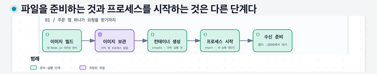
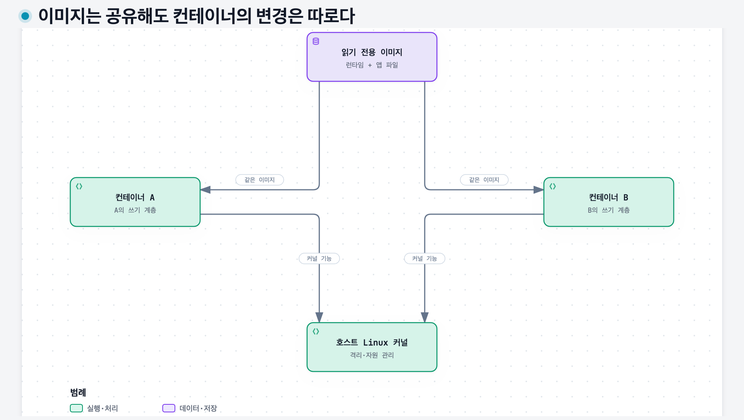
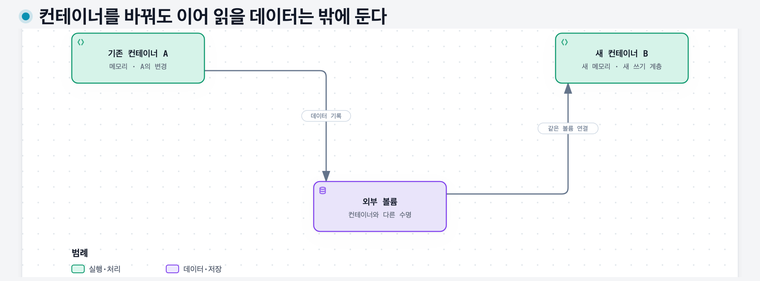

# 07. 다른 컴퓨터에서도 같은 프로그램을 실행하기 — 이미지와 컨테이너

## 이 장에서 배울 것

주문 앱의 파일을 준비하고 실행한 뒤 두 개로 늘리고 교체하는 과정을 따라간다. 매 단계에서 **저장된 파일, 실행 중인 프로세스, 메모리의 값**을 구분하면 된다. 계층·격리·볼륨이라는 이름은 그 과정에서 필요한 시점에 붙인다.

## 출발 상황과 선수 지식

[01장](01-computers-and-programs.md)의 파일·프로세스·메모리와 [02장](02-addresses-and-packets.md)의 소켓·포트를 사용한다. 예시는 Linux 컨테이너를 기준으로 한다. Docker 설치나 코드 작성은 필요 없으며, 아래 명령은 준비된 가상 이미지를 읽는 예다.

## 1. 프로그램 파일 밖에도 필요한 것이 있다

내 컴퓨터에서는 `node server.js`를 실행하면 주문 앱이 시작된다고 하자. `server.js`는 내가 작성한 앱 파일이고, `node`는 그 파일을 읽어 실행하는 Node.js 프로그램이다. 이런 실행 기반을 **런타임**이라고 한다. 앱이 사용하는 외부 코드 묶음은 **의존성**이다.

새 서버에 `server.js`만 복사했는데 Node.js가 없으면 시작 명령부터 실행할 수 없다. Node.js를 설치해도 필요한 의존성이 빠지면 앱이 시작하지 못할 수 있다. 파일이 있다는 것과 그 파일을 실행할 조건이 준비됐다는 것은 다르다.

서버마다 설치를 반복하는 대신, **실행에 필요한 파일과 시작 방법을 같은 묶음으로 전달**하면 누락과 버전 차이를 줄일 수 있다. 여기에 이미지가 쓰인다. 이 장에서는 그 준비와 실행을 관리하는 도구로 **Docker**를 사용한다.

## 2. 필요한 파일을 묶어 전달하는 이미지

**컨테이너 이미지**는 실행할 때 사용할 파일들과 기본 실행 정보를 담은 패키지다. 사진 이미지나 실행 중인 컴퓨터의 화면을 뜻하지 않는다. 가상의 `study-order:v1` 이미지에 다음을 준비했다고 하자. 경로는 이미지 안에서 사용할 위치를 단순화한 예다.

| 이미지에 준비한 것 | 구체적인 내용 |
|---|---|
| `/usr/local/bin/node`와 필요한 라이브러리 | Node.js 실행에 사용할 파일 |
| `/app/server.js` | 주문 요청을 받아 처리할 앱 코드 |
| `/app/node_modules/` | 이 앱이 사용하는 의존성 파일 |
| `/app/note.txt` | 처음에는 `빈 메모`라고 적힌 예시 파일 |
| 기본 시작 명령 | `node /app/server.js` |

개발자가 파일을 모으고 의존성을 설치하는 등의 절차로 이미지를 만드는 일을 **빌드**라고 한다. 보통 **Dockerfile**이라는 텍스트 파일에 준비 절차와 시작 명령을 적는다. 다른 사람이 만든 Node.js 기반 이미지에 내 앱과 의존성을 더할 수도 있다.

이 시점의 이미지는 저장된 파일과 정보다. **이미지를 만들기만 해서는 주문 앱의 프로세스도, 처리 중인 주문의 메모리도 생기지 않는다.** 01장의 프로그램 파일과 실행 중 프로세스의 차이를 떠올리자.

다른 컴퓨터로 전달할 때는 **레지스트리**라는 이미지 보관·배포 서비스에 올리고 실행할 컴퓨터가 내려받게 할 수 있다. 실행할 컴퓨터를 **호스트**라고 한다. 호스트에는 컨테이너 실행 도구와 호환되는 커널·CPU 환경 등이 필요하다. 이미지가 하드웨어와 운영체제 커널 전체를 포함하는 것은 아니다.

## 3. 이미지에서 주문 앱을 실행하면 무엇이 생길까

Docker에는 명령을 받는 CLI와, 호스트에서 생성·실행 등을 관리하는 **Docker Engine**이 있다. 터미널에서 명령하면 이 실행 관리 기능이 운영체제와 협력해 필요한 준비를 한다. 이미지를 CPU에 통째로 넣어 실행하는 방식이 아니다.

준비된 이미지가 호스트에 있다고 가정하고 다음 두 명령을 읽어 보자. 이 교재에는 실제 `study-order:v1` 이미지를 제공하지 않으므로 그대로 실행하는 실습은 아니다.

```bash
docker create --name order-a study-order:v1
docker start order-a
```

`--name order-a`는 새 컨테이너를 구분할 이름을 정한다. `create`는 이미지에서 **컨테이너 A를 만들지만 앱은 아직 시작하지 않는다.** A의 설정과 파일 변경을 둘 쓰기 영역 등이 준비되고, 시작 명령은 실행 전이다. 컨테이너라는 관리 대상은 프로세스가 멈춰 있을 때도 남을 수 있다.

`start`를 요청하면 실행 도구가 격리·네트워크·자원 설정 등 시작에 필요한 준비를 적용하고 기본 명령을 실행한다. 이 예에서는 A가 보는 파일 환경에서 Node.js가 `/app/server.js`를 실행한다. **호스트의 CPU가 수행하는 실제 프로세스**가 생기고, 처리할 주문과 변수는 그 프로세스의 메모리에 놓인다.

[](assets/diagrams/07-startup.png)

이미지는 파일과 시작 방법을 제공한다. 컨테이너는 그 파일을 바탕으로 별도 설정·변경 영역·실행 상태를 관리하는 단위다. 실행 중에는 격리된 프로세스가 일을 하고, 종료하면 프로세스는 끝나도 컨테이너의 설정과 파일 변경은 남을 수 있다. `docker run`은 생성과 시작을 함께 요청할 때 사용하는 명령이다.

프로세스가 시작됐다고 바로 주문을 받을 수 있는 것도 아니다. 이 앱은 설정을 읽고 `0.0.0.0:3000`에서 수신 대기를 시작하도록 만들었다고 가정하자. 그 지점까지 가야 자기 네트워크 환경의 3000번으로 온 연결을 받을 수 있다. 바깥에서 들어오는 경로는 5절에서 연결한다.

## 4. 같은 이미지로 두 번 실행하면 무엇이 같고 다를까

같은 이미지로 `order-b`도 생성·시작했다고 하자. B도 같은 앱 파일과 시작 명령을 사용하지만 **A에서 이미 진행 중인 주문이나 메모리를 복사해 이어받지 않는다.** 각각 새 프로세스를 실행한다.

앱이 시작할 때 메모리의 처리 건수를 0으로 두고 주문마다 하나씩 늘린다고 가정하자. A만 주문 세 건을 처리했다면 A는 3, B는 0이다. 같은 코드가 서로 다른 입력과 실행 상태를 가질 수 있다는 뜻이다. 새 B를 만드는 것이 요청을 A·B로 나누는 설정까지 자동으로 해 주지는 않는다.

이번에는 A가 `/app/note.txt`를 `주문 42 접수`로 바꾼다. A에서 다시 읽으면 바뀐 내용이 보인다. 하지만 B는 이미지의 원래 내용인 `빈 메모`를 본다. **공통 이미지의 파일을 직접 바꾼 것이 아니기 때문**이다.

이미지의 파일 변경 묶음을 **계층(layer)**이라고 한다. 읽기 전용 이미지 계층 위에 각 컨테이너의 **쓰기 계층**을 따로 두고, 합친 결과를 그 컨테이너의 파일시스템처럼 보이게 할 수 있다. 파일시스템은 앱이 경로로 파일을 찾고 읽고 쓰게 하는 체계다.

기존 이미지 파일을 수정할 때 컨테이너 쪽 변경 영역에 필요한 내용을 마련하는 **쓰기 시 복사(copy-on-write)** 방식이 쓰인다. A는 자기 변경을 먼저 보므로 새 메모를 읽고, 변경하지 않은 B는 원래 메모를 읽는다. 실제 복사 단위와 저장 방식은 구현에 따라 다르다.

[](assets/diagrams/07-layers.png)

읽기 전용 부분을 재사용하면 같은 런타임 파일을 매 컨테이너마다 통째로 복제할 필요를 줄일 수 있다. 이미 내려받은 동일한 계층은 이미지 전송에서도 재사용할 수 있다. **계층은 파일의 변경 묶음이지 CPU나 메모리를 쌓아 놓은 층이 아니다.**

## 5. 같은 호스트에서 실행하면서 어떻게 서로 구분할까

일반 프로세스를 둘 실행하는 것만으로는 파일·프로세스 목록·네트워크가 자동으로 별도 환경이 되지 않는다. 컨테이너 실행 도구는 Linux 커널의 기능을 사용해 **프로세스가 보는 자원의 범위**를 나눈다. 이 기능이 **네임스페이스**다. 커널은 운영체제에서 실행·메모리·장치 접근 등을 담당하는 핵심 부분이다.

A와 B가 별도 네트워크 네임스페이스를 쓰면, 둘 다 자기 환경의 3000번에서 수신해도 같은 수신 자리에서 충돌하는 것은 아니다. A의 `localhost`는 A의 네트워크 환경을 가리켜 B에 자동으로 연결되지 않는다. 반대로 설정으로 네트워크 범위를 공유할 수도 있다. 17장의 같은 Fargate 태스크가 그런 예다.

**호스트 포트와 컨테이너 포트도 구분한다.** A를 생성할 때 `-p 127.0.0.1:18080:3000`을 지정하면 호스트의 루프백 18080번에서 A의 3000번으로 전달하도록 게시하는 예가 된다. 호스트에서 `http://127.0.0.1:18080`에 접속하면 이 전달 경로를 사용한다. 이미지의 `EXPOSE 3000`은 포트 정보를 표현할 뿐 이 게시 설정을 대신하지 않는다.

B에는 다른 호스트 포트인 18081을 연결할 수 있다. 두 앱은 각각 자기 환경의 3000번을 쓰고 호스트의 입구는 18080·18081로 구분한다. 여기서는 호스트 루프백에만 게시했으므로 다른 컴퓨터의 직접 접속까지 허용한 설정은 아니다.

보이는 범위를 나누는 것과 **사용량을 제한**하는 것도 다르다. Linux의 **cgroup**은 프로세스들의 자원 사용을 묶어 측정하고 CPU·메모리 사용을 제한하는 데 쓰인다. CPU 시간 제한 때문에 더 실행하고 싶어도 차례가 제한될 수 있다. 메모리 한도에 이르고 회수도 안 되면 그룹 안 프로세스가 강제 종료될 수 있다. 이런 메모리 부족을 **OOM**이라고 한다.

그러므로 호스트 메모리가 남아 있어도 A의 한도가 부족할 수 있다. 컨테이너를 만들었다고 항상 자원 한도가 자동 설정되거나 모든 보안 위험이 사라지는 것도 아니다. 격리 범위·제한값·접근 권한은 실제 설정을 확인한다.

### 가상머신이라면 무엇이 달라질까

**가상머신(VM)**은 가상화된 하드웨어 위에서 별도의 게스트 운영체제와 커널을 실행한다. Linux 컨테이너 A·B는 각각 새 커널을 부팅하는 대신, 호스트 Linux 커널의 기능으로 프로세스를 구분한다. 이미지에 Linux 배포판의 파일이 들어 있어도 그 컨테이너가 독립된 커널을 부팅한다는 뜻은 아니다.

macOS에서 Linux 컨테이너를 쓸 때는 Linux 커널을 제공하는 VM이 중간에 있다. 컨테이너가 Mac 커널을 Linux 커널처럼 쓰는 것이 아니다. VM과 컨테이너를 함께 사용할 수 있으며, 같은 실행 호스트가 고장 나면 그 위의 여러 컨테이너가 함께 영향을 받을 수 있다.

## 6. 같은 컨테이너 재시작과 새 컨테이너 교체

A는 메모리의 처리 건수 3과 파일의 메모 `주문 42 접수`를 갖고 있다. 이제 A의 프로세스를 종료했다가 **같은 컨테이너 A를 다시 시작**한다. 새 프로세스의 메모리 변수는 초기값 0에서 시작하지만, A의 쓰기 계층을 유지했다면 메모 파일은 다시 읽을 수 있다.

반면 **A 자체를 삭제하고 같은 이미지에서 새 C를 생성**하면 A의 쓰기 계층은 C로 이어지지 않는다. C의 메모리는 새로 시작하고 `/app/note.txt`도 이미지의 `빈 메모`다. `start`로 같은 컨테이너를 다시 실행하는 것과 이미지에서 새 컨테이너를 만드는 것은 다른 사건이다.

| 관찰할 값 | A가 주문 처리 중 | 같은 A의 프로세스 재시작 | A 삭제 후 새 C 생성 |
|---|---|---|---|
| 메모리 처리 건수 | 3 | 초기값 0 | 초기값 0 |
| `/app/note.txt` | 주문 42 접수 | 주문 42 접수 | 이미지의 빈 메모 |

이제 영수증 사진은 컨테이너 교체 후에도 남아야 한다고 하자. 컨테이너와 **별도 수명으로 관리하는 저장 공간**을 준비하고 앱이 쓰는 경로에 연결할 수 있다. Docker의 **볼륨**이 이런 수단이다. 저장 공간을 사용할 경로에 연결하는 일을 **마운트**라고 한다.

이름 있는 볼륨을 A의 `/receipts`에 붙였다면 `/receipts/42.jpg`에 대한 쓰기는 그 볼륨으로 간다. 다른 곳에 쓴 모든 파일까지 볼륨에 저장되는 것은 아니다. 앱이 실제로 어느 경로에 쓰고 그 경로에 무엇이 연결됐는지 확인해야 한다.

A만 삭제하고 볼륨은 보존한 뒤 C에도 **같은 볼륨**을 `/receipts`에 연결하면 C가 그 사진을 이어 읽을 수 있다. 새 빈 볼륨을 같은 경로에 붙이는 것만으로는 예전 사진을 찾지 못한다. 경로의 이름과 실제 저장 공간의 식별은 다르다.

[](assets/diagrams/07-storage-life.png)

볼륨은 저절로 별도 서버의 안전한 저장소가 되는 것이 아니다. 사용하는 저장 기반과 삭제 방식에 따라 함께 잃을 수도 있다. 컨테이너 삭제에서 분리한 수명과 저장 장치 고장·실수에 대비하는 **백업**은 다른 문제다.

## 7. 이미지가 같아도 설정은 다를 수 있다

이미지를 바꾸지 않고 실행할 때 설정을 공급할 수 있다. **환경변수**는 프로그램이 시작할 때 읽는 이름·값의 쌍이다. 예를 들어 `PORT=3000`을 주어도 앱이 PORT를 읽고 그 포트에서 수신하도록 작성돼 있어야 한다. 아무 이름이나 넣으면 앱의 동작이 자동으로 바뀌는 것은 아니다.

이미지가 같아도 설정·시크릿·권한·마운트·네트워크·자원 한도가 다르면 실행 결과는 달라질 수 있다. 이미지가 실행 환경 전체와 외부 서비스까지 봉인하는 것은 아니다. 비밀번호 같은 **시크릿**은 이미지에 넣어 배포하기보다 별도 수단으로 공급한다. 자세한 권한과 비밀 공급은 16장에서 다룬다.

`study-order:v1`의 `v1`은 **태그**, 즉 이름표다. 같은 태그가 나중에 새 콘텐츠를 가리키게 될 수 있다. **다이제스트**는 이미지 콘텐츠의 식별값이다. 이전 실행과 새 실행이 실제로 같은 산출물을 선택했는지 비교하려면 이름표만 보지 않는다. CPU 아키텍처 등 실행 플랫폼의 호환성도 따로 확인한다.

## 실행 재현성과 배포에 대입하기

새 버전에서는 기존 A의 파일을 그때그때 고치기보다, 변경한 앱 파일로 새 이미지를 빌드하고 새 컨테이너를 준비할 수 있다. 이때 새 C가 무엇을 읽는지 설명해 보자. 앱·런타임 파일은 선택한 이미지에서, 설정은 실행 시 공급에서, 영수증은 연결한 볼륨에서 얻는다. A의 작업 메모리는 자동으로 가져오지 않는다.

배포 실패도 단계로 나눈다. 이미지를 못 받았는지, 시작 명령이 실패했는지, 프로세스는 떴지만 수신 준비가 안 됐는지, 바깥 입구 연결이 안 됐는지는 서로 다른 사건이다. 새 요청을 보내고 기존 A를 안전하게 끝내는 방법은 13장에서 이어 배운다.

## 꼭 기억할 것

- **카드 08:** 이미지는 실행에 사용할 파일·기본 설정이고, 컨테이너는 그것을 바탕으로 관리하는 별도 실행 환경이다. 실행 중 프로세스 메모리·컨테이너 파일 변경·연결한 볼륨의 수명은 다르다.

## 자가 진단

먼저 답을 적은 뒤 접힌 해설을 연다. 이어 [워크북](../workbook/92-workbook.md)의 1-8번으로 확인한다. 막히면 [단계별 힌트](../workbook/94-hints.md), 답을 쓴 뒤에는 [필수 기준·오개념별 복습](../workbook/93-solutions.md)을 사용한다.

<details><summary>이미지를 만들고 docker create까지 끝냈다. 왜 아직 주문을 받지 못할까?</summary>

이미지와 컨테이너를 준비했지만 프로세스가 아직 시작하지 않았다. 시작 뒤에도 앱의 초기화·수신과 접속 경로가 맞아야 한다.
</details>

<details><summary>A가 메모리의 건수와 메모 파일을 바꿨다. 같은 이미지의 B도 같은 값을 볼까?</summary>

메모리는 각각 별도이고 A의 파일 변경도 A의 쓰기 계층에 있다. 이 예에서는 B의 건수는 0이고 메모는 이미지의 빈 메모다.
</details>

<details><summary>같은 A의 프로세스를 다시 시작하는 것과 A를 삭제하고 새 C를 만드는 것은 어떻게 다를까?</summary>

둘 다 새 프로세스 메모리로 시작하지만, 같은 A는 자기 쓰기 계층을 유지할 수 있다. 새 C는 A의 파일 변경을 자동으로 이어받지 않는다.
</details>

<details><summary>A를 지우고 C에 /receipts라는 경로만 만들었다. 예전 사진이 있을까?</summary>

경로만 같다고 같은 저장 공간은 아니다. A가 사용한 볼륨을 보존하고 C에도 그 볼륨을 연결해야 사진을 이어 읽을 수 있다.
</details>

## 근거와 다음 장

2026-11-10에 Docker의 [이미지](https://docs.docker.com/get-started/docker-concepts/the-basics/what-is-an-image/), [컨테이너](https://docs.docker.com/get-started/docker-concepts/the-basics/what-is-a-container/), [생성 명령](https://docs.docker.com/reference/cli/docker/container/create/), [계층과 쓰기 시 복사](https://docs.docker.com/engine/storage/drivers/), [포트 게시](https://docs.docker.com/get-started/docker-concepts/running-containers/publishing-ports/), [볼륨](https://docs.docker.com/engine/storage/volumes/), [자원 제한](https://docs.docker.com/engine/containers/resource_constraints/)을 확인했다. 계층은 구현 원리를 설명하며 특정 Docker 버전의 저장 드라이버 설정을 지시하지 않는다. 다음 [08장](08-storage-and-databases.md)은 남긴 데이터를 찾고 함께 바꾸는 방법을 다룬다.
