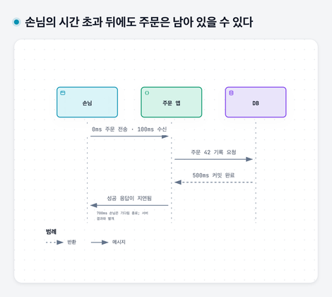
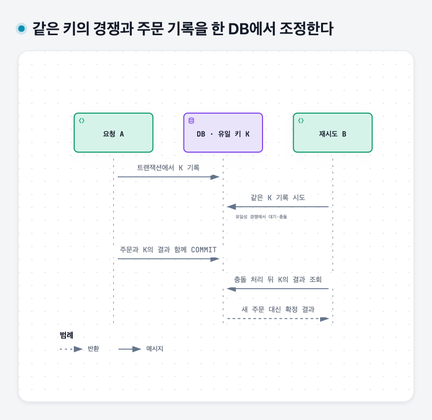

# 11. 답을 못 받았으면 다시 보내도 될까 — 시간 초과와 멱등성

## 이 장에서 배울 것

호출자가 응답을 못 받은 상태와 원격 작업 실패를 구분한다. 전체 시간 예산 안에서 재시도를 배치하고, 같은 키의 두 요청을 DB가 경쟁 조정하는 과정을 설명한다.

## 출발 상황과 선수 지식

[03장](03-dns-and-http.md)의 요청·응답과 [09장](09-transactions-and-recovery.md)의 커밋을 알고 시작한다. 손님이 주문 버튼을 눌렀는데 화면이 계속 기다린다. 앱이 “시간 초과”를 표시했다. 주문은 실패한 것일까?

## 1. 호출자는 얼마나 기다릴지 정해야 한다

상대가 고장 나면 응답이 영원히 오지 않을 수 있다. 기다리는 요청은 메모리와 연결 같은 자원도 붙잡는다. 그래서 기다릴 한도를 정한다. 그 한도에 도달해 기다림을 끝내는 것이 **타임아웃**, 즉 시간 초과다.

연결을 준비하는 시간, 응답을 기다리는 시간, 모든 과정을 포함한 전체 한도는 서로 다를 수 있다. 어떤 옵션이 무엇까지 제한하는지는 사용하는 도구에서 확인한다.

시간 초과는 호출자의 시계에서 일어난 사건이다. 상대가 실제로 무엇을 했는지를 자동으로 알려 주는 응답은 아니다.

### 각 호출에 새 한도를 주면 전체는 얼마나 기다릴까

사용자 요청 전체에 1,000 ms를 쓸 수 있다고 가정하자. 첫 시도에 300 ms를 썼고 재시도 전 100 ms 기다렸다면 남은 예산은 600 ms다. 두 번째 시도에 또 1,000 ms를 주면 사용자에게 약속한 전체 한도를 넘길 수 있다.

**데드라인**은 작업을 마쳐야 하는 한계 시점이다. 하위 호출에 남은 예산을 반영하고 연결·실행·재시도 대기 시간을 그 안에 포함해야 한다. 시간 초과를 설정할 때는 “연결만 제한하는가, 데이터가 올 때마다 다시 세는가, 전체 시간을 제한하는가”를 구분한다. 같은 숫자를 썼다는 이유로 같은 동작이라고 볼 수 없다.

한도가 너무 짧으면 정상 요청도 재시도해 부하를 늘리고, 너무 길면 실패한 요청이 자원을 오래 붙잡는다. 실제 지연 분포와 사용자 목표를 근거로 정하는 이유다.

## 2. 서버는 저장했는데 손님은 모를 수 있다

아래 시간은 설명을 위한 가정이며 실제 서비스의 성능 수치가 아니다.

| 경과 시간 | 손님 쪽 | 서버 쪽 |
|---|---|---|
| 0 ms | 주문 요청 전송 | |
| 100 ms | 응답 대기 | 주문 요청 수신 |
| 500 ms | 응답 대기 | 주문 42 저장·커밋 |
| 700 ms | 기다림 한도에 도달 | 응답 전달이 지연됨 |
| 이후 | 실패처럼 보이는 화면 | 주문은 이미 존재 |

이 경우 손님의 “답을 못 받음”과 서버의 “주문 저장 실패”는 같지 않다. 요청이 서버에 도착하기 전 실패했을 가능성도, 아직 처리 중일 가능성도 있다. 답이 없다는 관찰만으로 어느 경우인지 구분할 수 없다.

호출자의 기다림이 끝나도 서버의 실행이 자동 취소되는 것은 아니다. 취소를 전달하고 상대가 협력하는 별도 구조가 있어야 할 수 있다.

손님의 시간 초과 뒤에도 주문은 남아 있을 수 있다 — 본문의 가상 시각이며 세로 간격은 시간에 비례하지 않는다. 700ms의 시간 초과는 손님의 기다림 종료이고, 500ms의 DB 커밋을 취소하지 않는다.

## 3. 재시도는 일시적인 실패에 도움이 될 수 있다

**재시도**는 같은 작업 의도를 다시 요청하는 것이다. 잠깐 끊긴 연결이 회복됐다면 다음 시도는 성공할 수 있다.

하지만 상품 번호가 잘못됐거나 권한이 없는 오류는 같은 요청을 반복한다고 고쳐지지 않는다. 서버가 이미 과부하라면 추가 호출이 문제를 키울 수 있다. 무엇을 다시 시도할지와 언제 그만둘지를 정해야 한다.

## 4. 여러 계층이 재시도하면 일이 곱해진다

브라우저에서 주문 앱으로, 주문 앱에서 내부 서비스로, 내부 서비스에서 외부 서비스로 호출이 이어진다고 하자. 세 지점이 각각 최대 세 번 시도하고 모든 시도가 실패하는 가상 사례를 생각하자.

최종 외부 서비스에는 최초 사용자 요청 하나당 `3 × 3 × 3 = 27`번의 시도가 갈 수 있다. 여기의 세 번은 처음 시도까지 포함한 총 횟수다.

장애 난 곳에 일이 더 몰리는 구조다. 재시도 책임을 어느 계층이 맡는지, 전체 요청의 시간 예산 안에서 최대 몇 번 할지 정한다.

## 5. 백오프와 지터는 시도를 덜 몰리게 한다

**백오프**는 시도 사이의 기다림을 늘리는 방식이다. 실패 즉시 계속 두드리는 대신 잠시 기다렸다 다시 시도한다. **지터**는 그 기다림에 변화를 주어 여러 호출자의 시도 시각을 흩뜨리는 방식이다.

가정상 천 명이 모두 같은 간격으로 재시도하면 같은 시각에 다시 천 요청이 올 수 있다. 기다림을 흩뜨리면 한꺼번에 몰리는 정도를 줄일 수 있다. 여전히 횟수와 전체 예산의 제한은 필요하다.

이 방법은 호출 부하를 다룬다. 이미 저장된 주문이 또 생성되는 문제까지 해결하지는 않는다.

### 기다림을 실제 숫자로 정해 보기

설명용 지수 백오프에서는 첫 재시도 앞에 100 ms, 다음에는 200 ms, 그다음에는 400 ms를 기다리는 식으로 늘리고 상한을 둔다. **지수**라는 말은 매 단계에서 같은 배수를 곱한다는 뜻이다. 지터를 넣는 한 방식은 각 대기 상한 안에서 무작위 시간을 고르는 것이다.

호출자가 많아도 같은 시각에 일제히 재시도하는 정도를 줄일 수 있다. 그러나 대기 시간도 전체 예산을 쓴다. 남은 예산으로 다음 시도를 끝내기 어렵다면 횟수가 남아도 중단해야 한다. 서버가 재시도 시점을 알려 주는 경우에는 그 계약도 따른다.

재시도를 어디서 할지도 중요하다. TCP는 같은 연결의 바이트 손실을 복구하지만 업무 요청의 재실행을 결정하지 않는다. HTTP 클라이언트나 앱이 별도로 재시도한다면 이미 성공한 업무를 다시 수행할 위험을 알아야 한다.

## 6. 같은 업무 의도를 알아보는 식별자

손님이 주문 42의 응답을 못 받아 다시 보냈다고 하자. 서버가 이를 새 주문으로만 해석하면 주문이 두 개 생긴다.

한 방법은 손님 쪽이 “이번 주문 의도”를 나타내는 키 K를 만들고, 재시도에도 같은 키를 보내는 것이다. 서버는 K로 처리 결과를 찾거나 같은 처리에 연결한다.

**멱등성**은 같은 의도로 반복한 작업이 한 번 수행한 것과 같은 효과를 내는 성질이다. 반드시 응답 바이트가 매번 완전히 같아야 한다는 뜻은 아니다. 업무 효과가 추가로 중복되지 않는지가 핵심이다.

상품과 수량이 같은 주문 두 개를 손님이 의도적으로 따로 할 수도 있다. 따라서 본문이 같다는 이유만으로 무조건 같은 의도로 합치면 안 된다. 반대로 재시도 때 새 키를 만들면 새 의도로 처리될 수 있다.

## 7. 두 요청이 동시에 오면 키만 있어도 충분할까

A와 B가 같은 키 K로 동시에 들어오면 둘 다 “아직 K가 없다”고 읽을 수 있다. 두 요청이 각자 주문을 생성하면 키를 사용하고도 중복이 생긴다.

그래서 키 기록과 업무 변경을 원자적으로 묶고, 같은 키의 동시 경쟁을 DB의 유일성 제약 등으로 조정해야 한다. 09장의 트랜잭션과 동시성 문제가 다시 등장한 것이다.

유일성 제약은 같은 값이 중복 저장되지 않게 DB가 검사하는 규칙이다. K를 기록한 뒤 주문을 저장하기 전에 실패하거나, 주문만 저장하고 K를 놓치는 경우도 막아야 한다. 외부 결제가 있으면 제공자 측의 조회·멱등 처리 계약까지 연결한다.

### 같은 키 K가 동시에 들어오는 과정을 조정하기

같은 DB 안에서 주문 효과를 처리하는 예를 구체화하자. 서버는 키의 범위를 사용자·작업 종류·키 값으로 구분하고, 같은 범위의 키에 **유일성 제약**을 둔다. 키에 연결된 요청 내용의 식별 정보와 주문 결과도 보관한다.

1. A가 트랜잭션을 시작하고 K를 기록한다. 아직 다른 트랜잭션에 확정된 기록은 아니다.
2. B도 같은 K를 기록하려 하지만 DB의 유일성 경쟁에서 기다리거나 충돌한다. 둘 다 독립적인 성공 처리자가 되게 두지 않는다.
3. A가 주문을 만들고 K에 주문 결과를 연결한 뒤 함께 커밋한다.
4. B는 중복 키를 새 주문으로 처리하지 않고, 필요한 오류 정리 뒤 확정된 K의 결과를 조회해 돌려준다.

A가 커밋 전에 실패해 롤백하면 주문과 K 기록이 함께 취소된다. 이후 시도가 다시 처리할 수 있다. 주문만 확정하고 K를 나중에 쓰면 그 사이 장애로 중복을 막을 근거가 사라지므로 두 기록을 함께 확정하는 것이 중요하다.

이것은 **한 DB 안의 효과**에 대한 예다. 외부 결제를 호출하면 그 회사의 멱등 키·결과 조회·실패 계약까지 연결해야 한다. 로컬 DB의 유일성 제약이 원격 결제를 되돌리거나 한 번만 실행하게 만드는 것은 아니다.

같은 키의 경쟁과 주문 기록을 한 DB에서 조정한다 — 사용자·작업 범위가 같은 K의 경쟁이다. K와 주문을 함께 커밋하고, B는 확정 결과를 재사용한다. 외부 결제의 효과까지 이 DB가 보장하는 것은 아니다.

## 8. 결과 조회도 복구 절차의 일부다

화면에서 실패처럼 보이면 즉시 새 업무를 만드는 대신 원래 키나 주문 식별자로 상태를 확인할 수 있게 설계한다. 처리 중·완료·확정 실패를 구분하면 손님에게도 현재 상태를 설명하기 쉽다.

키의 보관 기간과 같은 키에 다른 상품 정보를 보냈을 때의 처리도 정한다. “키를 붙였다”는 사실만으로 전체 실패 상황의 계약이 완성되지는 않는다.

### 키의 범위와 수명도 업무 계약이다

고객 A의 K와 고객 B의 K를 무조건 같은 주문으로 합치면 안 된다. 같은 고객이 같은 K에 다른 상품·수량을 보내면 기존 결과를 그대로 돌려주기보다 요청 충돌로 거절하는 등의 계약이 필요하다. 요청 내용의 식별 정보를 함께 두는 이유다.

K를 보관하는 기간이 끝난 뒤 같은 요청이 오면 서버는 예전 처리 여부를 더는 구별하지 못할 수 있다. 따라서 클라이언트의 재시도 가능 기간과 서버 기록 수명을 맞춘다. 멱등 키는 붙이는 순간 영원한 보장이 생기는 표지가 아니라, 의도와 기록·경쟁·보관 기간을 함께 정하는 설계다.

## 꼭 기억할 것

- **카드 12:** 시간 초과는 원격 업무 실패의 증명이 아니다. 재시도에는 결과 확인과 중복 효과 방지, 횟수·시간·부하 제한이 함께 필요하다.

## 자가 진단

답을 먼저 적은 뒤 접힌 해설을 연다. 이어 [워크북](../workbook/92-workbook.md)의 1-12번으로 확인한다. 막히면 [단계별 힌트](../workbook/94-hints.md), 답을 쓴 뒤에는 [필수 기준·오개념별 복습](../workbook/93-solutions.md)을 사용한다.

주문 응답이 없을 때 서버에서 가능한 상태는 무엇일까?

아직 받지 못함, 처리 중, 이미 완료했으나 응답이 전달되지 않음 등이 가능하다. 호출자의 시간 초과만으로 구분할 수 없다.

지터를 넣으면 같은 주문의 중복 생성도 막힐까?

아니다. 시도를 흩뜨리는 부하 조절과 업무의 중복 효과 방지는 다른 문제다. 같은 의도를 식별하고 원자적으로 처리해야 한다.

같은 키가 없으면 생성한다는 코드를 두 요청이 동시에 실행하면 어떤 위험이 있을까?

둘 다 없다고 읽고 각각 생성할 수 있다. 동시 경쟁을 조정하는 제약과 원자적 업무 변경이 필요하다.

키 K를 먼저 저장해 놓고 주문 저장은 별도 트랜잭션으로 하면 어떤 실패 구간이 생길까?

K만 확정한 뒤 주문을 만들기 전에 죽으면 중복이라는 기록만 있고 주문은 없을 수 있다. 반대로 주문을 먼저 확정하면 K 기록 전 실패로 재시도가 새 주문을 만들 수 있다. 같은 DB의 효과라면 두 기록을 함께 확정하는 이유다.

## 근거와 다음 장

Amazon의 [재시도와 백오프](https://aws.amazon.com/builders-library/timeouts-retries-and-backoff-with-jitter/), [멱등 API](https://aws.amazon.com/builders-library/making-retries-safe-with-idempotent-APIs/)를 참고했다. 다음 [12장](12-caches-and-queues.md)은 읽기 재사용과 비동기 작업을 다룬다.
