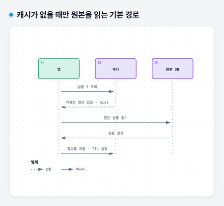
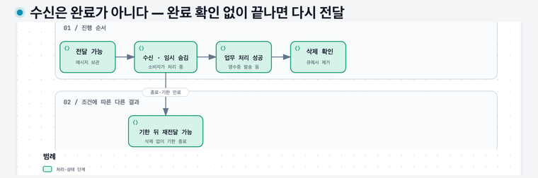
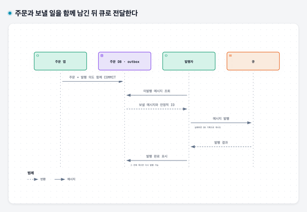

# 12. 같은 일을 덜 하고 느린 일을 나누기 — 캐시와 큐

## 이 장에서 배울 것

캐시 적중·부적중과 갱신 경쟁을 시간 순서로 설명한다. 큐가 메시지를 보관·임시 전달·완료 처리하는 과정을 따라가고, DB 저장과 메시지 발행 사이의 누락을 막는 원리를 이해한다.

## 출발 상황과 선수 지식

[08장](08-storage-and-databases.md)의 DB 읽기와 [11장](11-timeouts-and-retries.md)의 중복 처리를 알고 시작한다. 문구점 손님들이 같은 상품 정보를 자주 읽고, 주문 뒤 영수증을 보내는 작업은 오래 걸린다고 하자. 두 문제는 서로 다른 도구로 풀 수 있다.

## 1. 같은 상품을 읽을 때마다 DB를 찾아야 할까

상품 이름과 설명이 자주 바뀌지 않는다면, 한 번 읽은 결과를 잠시 저장해 다음 요청에 재사용할 수 있다. 이렇게 원본의 결과를 재사용하기 위해 보관한 것을 **캐시**라고 한다. 03장의 DNS 캐시와 같은 발상이다.

DB를 진실의 기준으로 삼는 예에서 다음처럼 동작할 수 있다.

1. 앱은 상품 7의 결과가 캐시에 있는지 본다.
2. 유효한 결과가 있으면 그것을 사용한다. 이를 **캐시 적중(hit)**이라고 한다.
3. 결과가 없거나 만료됐으면 DB에서 읽는다. 이를 **캐시 부적중(miss)**이라고 한다.
4. DB에서 읽은 결과를 캐시에 넣고 손님에게 응답한다.

이것은 한 가지 캐시 사용 방식이다. 캐시를 두었다고 앱과 DB 사이의 모든 문제가 사라지는 것은 아니다.

캐시가 없을 때만 원본을 읽는 기본 경로 — 캐시 어사이드의 부적중 경로다. 적중이면 DB 읽기를 건너뛴다. 캐시에 넣는 시점과 원본 변경이 경쟁할 수 있다는 문제는 다음 절과 별개로 남는다.

## 2. 캐시의 값은 언제 오래될까

캐시에 상품 7의 가격이 1,000원이라고 저장돼 있다고 하자. DB의 가격이 1,200원으로 바뀌었는데 캐시는 그대로면 다음 조회는 예전 값을 줄 수 있다. 숫자는 설명용 가정이다.

캐시를 갱신하거나 지워서 다음 읽기에 새 결과를 가져오게 해야 한다. 이런 처리를 **무효화**라고 부른다. 일정 시간이 지나면 유효하지 않게 하는 **만료**도 사용한다.

만료 시간을 길게 두면 재사용은 많아질 수 있지만 오래된 값을 보는 기간도 길어질 수 있다. 짧게 두면 새 값을 더 빨리 읽을 수 있지만 원본을 더 자주 읽는다. 허용할 오래됨은 업무마다 다르다.

상품 소개 문구의 잠깐 오래된 값과 결제 시 확정할 가격·재고는 같은 요구가 아니다. 주문을 확정할 때 어떤 저장소의 어떤 값을 기준으로 검증할지 정해야 한다.

### DB를 바꾸고 캐시를 지워도 오래된 값이 다시 들어갈 수 있다

캐시를 확인하고 없으면 DB에서 읽어 채우는 방식을 **캐시 어사이드(cache-aside)**라고 한다. 읽기와 갱신이 겹치면 다음 경쟁이 생길 수 있다.

| 순서 | 읽는 요청 A | 가격을 바꾸는 요청 B |
|---|---|---|
| 1 | 캐시에 없어 DB의 1,000원을 읽음 | |
| 2 | 읽은 값을 아직 캐시에 넣지 못함 | DB를 1,200원으로 바꾸고 캐시를 지움 |
| 3 | 이전에 읽은 1,000원을 캐시에 넣음 | |

“쓰기 뒤 삭제” 순서가 있어도 읽기와 경쟁하면 오래된 값이 재등장할 수 있다. 만료는 오래된 값이 남을 시간을 줄이는 수단이지만 즉시 최신성을 보장하지 않는다. 요구가 엄격한 가격·재고의 확정은 기준 저장소에서 다시 검증하거나 버전·동시성 제어까지 설계해야 한다.

또 캐시의 TTL은 저장 시점부터 계산되므로, 원본을 읽은 뒤 지연돼 넣은 값의 실제 오래됨과 꼭 같지 않다. 캐시 수명 숫자만으로 최신성 계약을 완성할 수 없는 이유다.

## 3. 캐시가 없어졌을 때의 경로도 본다

캐시가 비거나 많은 키가 동시에 만료되면 앱들이 한꺼번에 DB로 갈 수 있다. 평소 캐시 적중이 많았다는 이유만으로 DB가 그 부하를 감당할 것이라고 보장할 수 없다.

같은 상품을 동시에 다시 읽으려는 작업을 합치거나 만료 시점을 흩뜨리는 방법을 검토할 수 있다. 중요한 질문은 “평소 얼마나 빠른가?”와 함께 “캐시를 못 쓸 때 어느 경로로 일이 몰리는가?”다.

### 한 번의 부적중이 왜 갑자기 많은 DB 요청이 될까

같은 상품 키가 만료된 순간 손님 100명이 조회하면, 각 앱이 모두 “없다”고 보고 DB를 100번 읽을 수 있다. 이런 동시 재조회가 **캐시 스탬피드**다. 같은 키의 갱신 작업 하나만 먼저 진행하고 나머지가 그 결과를 기다리게 합치는 방법이 있다.

하지만 앱 A 안에서만 합치면 앱 B의 동시 갱신까지 막지는 않는다. 조정 범위를 정하고 갱신 실행자가 죽었을 때 기다림을 풀 방법도 필요하다. 캐시가 아예 장애일 때 무제한으로 DB에 우회하면 더 큰 장애가 될 수 있으므로, 원본이 감당할 유입 한도까지 함께 본다.

## 4. 주문 응답 전에 영수증 발송까지 끝내야 할까

주문 저장은 끝났는데 메일 발송이 오래 걸린다고 하자. 업무상 영수증을 조금 뒤에 보내도 된다면, 발송할 작업을 기록하고 주문 접수 응답을 먼저 보낼 수 있다.

이때 처리할 작업을 쌓아 둘 수 있는 수단이 **큐(queue)**다. 일을 넣는 쪽은 **생산자**, 꺼내 처리하는 쪽은 **소비자**라고 부른다.

주문 앱은 “주문 42의 영수증을 보낸다”는 메시지를 큐에 넣는다. 별도 작업 프로그램이 이를 꺼내 메일을 보낸다. 메시지는 이런 작업 내용을 표현한 데이터다.

응답이 빨라져도 메일이 그 순간 이미 발송된 것은 아니다. 손님에게 “주문 접수 완료”와 “영수증 발송 완료”를 구분해 알려야 한다.

## 5. 소비자가 죽으면 그 일은 끝난 것일까

큐는 메시지를 소비자에게 전달하고, 소비자는 처리가 끝났다고 확인 응답을 보낼 수 있다. 이를 **acknowledgement**, 줄여 **ack**라고 한다. 상세 규칙은 큐 제품에 따라 다르다.

소비자가 영수증을 발송한 뒤 ack를 보내기 전에 종료됐다고 하자. 큐 입장에서는 처리가 끝났는지 모를 수 있다. 다시 전달하도록 설계된 시스템에서는 다른 소비자가 같은 메시지를 받아 영수증을 한 번 더 보낼 수 있다.

이는 11장에서 배운 결과 불확실성과 닮았다. 메시지에 안정적인 식별자를 두고, 이미 완료한 업무인지 확인하는 등 소비자도 중복 효과를 다뤄야 한다. 중복 방지가 외부 발송 효과까지 어떻게 연결되는지도 확인한다.

### 꺼내자마자 지우는 대신 처리할 기회를 임시로 준다

소비자가 받는 순간 메시지를 영구 삭제하면 작업 전에 죽었을 때 일도 사라진다. 그래서 일부 큐는 메시지를 보존한 채 일정 시간 다른 소비자에게 보이지 않게 하거나, 처리 중 상태로 둔다. 완료 확인 뒤에 제거하고 확인 없이 기한이 끝나면 다시 처리할 수 있게 한다.

SQS에서는 이를 **가시성 제한 시간(visibility timeout)**으로 다룬다. 소비자가 수신한 메시지는 잠시 숨겨지고, 완료 후 삭제한다. 너무 짧으면 첫 소비자가 처리 중인데 재전달될 수 있고, 너무 길면 죽은 소비자의 일을 다시 맡기기까지 오래 기다린다. 숨김이 표준 큐의 모든 중복 전달 가능성을 없애는 보장은 아니다.

제품에 따라 ack와 삭제의 방식, 순서와 중복 보장이 다르다. 작업 실패가 영구적이면 무한 재시도를 피하고 정해진 횟수 뒤 별도 보관할 수 있다. 이런 격리용 큐를 **실패 메시지 큐(DLQ)**라고 부른다. 옮겼다고 업무가 복구된 것은 아니므로 원인 확인과 재처리 절차가 필요하다.

수신은 완료가 아니다 — 완료 확인 없이 끝나면 다시 전달 — SQS식 임시 숨김의 핵심 경로다. 소비자가 업무 효과를 실행한 뒤 삭제 전에 죽으면 재전달될 수 있어, 메시지 삭제와 업무 효과의 중복 방지를 구분한다.

## 6. 큐는 처리 능력을 자동으로 늘리지 않는다

설명용으로 초당 10개 작업이 들어오는데 소비자가 초당 8개만 끝낸다고 가정하자. 같은 상태가 계속되면 대기 작업은 초당 2개씩 늘어난다. 처음 비어 있고 30초 동안 다른 변화가 없다면 60개가 남는다.

이 대기를 **적체(backlog)**라고 부른다. 큐는 순간적으로 몰린 일을 완충할 수 있지만 지속적으로 부족한 처리 능력을 없애지는 않는다.

대기 중인 수량과 가장 오래 기다린 작업의 나이, 실패와 재처리 수를 관찰한다. 처리 속도를 늘릴지, 유입을 제한할지, 업무 요구를 바꿀지는 관측에 따라 판단한다.

### 주문은 저장했는데 큐에 넣기 전에 앱이 죽으면

DB 커밋 뒤에 큐로 발송 요청을 보내는 두 작업 사이에서 앱이 종료되면, 주문은 있는데 영수증 작업은 없다. 반대로 큐부터 보내면 롤백된 주문의 영수증이 나갈 수 있다. DB의 트랜잭션이 별도 큐까지 자동으로 확장되지 않는 문제다.

**트랜잭셔널 아웃박스(outbox)**는 주문과 “나중에 발행할 메시지”를 같은 DB 트랜잭션으로 기록하는 방식이다. 별도 발행자가 DB의 미발행 기록을 읽어 큐에 보내고 발행 상태를 갱신한다. 발행이 잠시 실패해도 DB에 보낼 일이 남아 있어 다시 시도할 수 있다.

발행자가 큐에 보낸 뒤 발행 완료 표시 전에 죽으면 메시지는 다시 나갈 수 있다. 아웃박스는 **주문과 발행 의도의 기록 누락**을 해결하지만 중복 전달까지 없애지는 않는다. 안정적인 메시지 식별자와 소비자의 멱등 처리가 계속 필요하다. [AWS 아웃박스 설명](https://docs.aws.amazon.com/prescriptive-guidance/latest/cloud-design-patterns/transactional-outbox.html)을 참고했다.

주문과 보낼 일을 함께 남긴 뒤 큐로 전달한다 — DB와 큐에 걸친 한 번의 원자적 커밋이 아니다. 같은 DB에 발행 의도를 남기고 발행자가 재시도한다. 발행 후 완료 표시 전 장애에서는 중복이 가능하다.

## 7. 두 도구를 함께 쓰는 주문 서비스

상품 조회는 캐시로 재사용하고 주문 확정은 DB에서 검증할 수 있다. 주문 뒤 발송 작업은 큐로 전달하고 별도 소비자가 처리할 수 있다.

캐시는 원본 결과의 재사용 문제를, 큐는 일을 넘기고 속도 차이를 흡수하는 문제를 다룬다. 둘 다 필요 없는 작은 시스템도 있다. 무엇이 느리고, 얼마나 오래된 값과 완료 지연을 허용하는지 설명한 뒤 도입한다.

## 꼭 기억할 것

- **카드 13:** 캐시는 원본 접근을 줄이는 대신 오래된 값을 다루고, 큐는 작업을 나누는 대신 완료 지연·적체·재전달을 다룬다.

## 자가 진단

답을 먼저 적은 뒤 접힌 해설을 연다. 이어 [워크북](../workbook/92-workbook.md)의 1-13, 2-2, 2-5번으로 확인한다. 막히면 [단계별 힌트](../workbook/94-hints.md), 답을 쓴 뒤에는 [필수 기준·오개념별 복습](../workbook/93-solutions.md)을 사용한다.

캐시의 상품 가격과 DB 가격이 다를 때 주문 확정은 무엇을 기준으로 해야 할까?

업무 계약에서 정한 기준으로 다시 검증해야 한다. 오래된 캐시 값을 읽었다는 사실만으로 현재 가격과 재고의 확정을 대신할 수 없다.

영수증을 보낸 뒤 소비자가 ack 전에 종료되면 어떤 일이 가능할까?

재전달되는 시스템이라면 같은 메시지가 다시 처리돼 중복 발송될 수 있다. 업무 효과의 중복 방지까지 설계해야 한다.

초당 10개가 들어오고 8개가 끝나는 큐를 오래 유지하면 어떻게 될까?

같은 가정이 계속되면 적체와 대기 시간이 늘어난다. 큐가 처리 능력을 저절로 늘리지는 않는다.

DB 커밋 뒤 큐 발행 전 장애에 대비하려면 무엇을 같은 트랜잭션에 남길까?

주문 변경과 나중에 발행할 메시지 기록을 같은 DB 안에서 함께 확정한다. 별도 발행자가 그 기록을 보고 재시도할 수 있다. 발행 후 상태 기록 전 장애에서는 중복이 가능해 소비자 멱등성도 필요하다.

## 근거와 다음 장

Amazon의 [캐시 설명](https://aws.amazon.com/builders-library/caching-challenges-and-strategies/)과 [SQS 재전달 설명](https://docs.aws.amazon.com/AWSSimpleQueueService/latest/SQSDeveloperGuide/standard-queues-at-least-once-delivery.html), [가시성 제한 시간](https://docs.aws.amazon.com/AWSSimpleQueueService/latest/SQSDeveloperGuide/sqs-visibility-timeout.html)을 참고했다. 다음 [13장](13-deployment-and-shutdown.md)은 실행 중인 앱의 교체를 다룬다.
