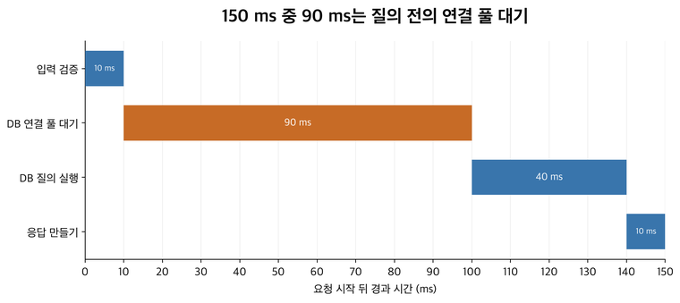
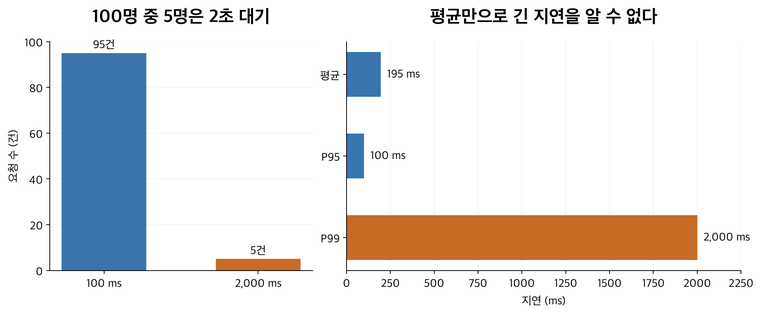

# 15. 느리다는 말을 증거로 바꾸기 — 로그·지표·추적

## 이 장에서 배울 것

앱의 측정이 로그·메트릭·추적으로 남는 과정을 설명한다. 누적값과 구간값, 평균과 분위수를 구분해 원인 후보를 좁힌다. 시스템 내부·사용자 서비스 품질·업무 성과를 연결하고, 개발자가 책임질 측정과 함께 정할 목표를 구분한다.

## 출발 상황과 선수 지식

[06장](06-processes-and-concurrency.md)의 계산과 대기, [08장](08-storage-and-databases.md)의 연결 풀을 알고 시작한다. 새 버전 배포 뒤 손님이 “주문 화면이 느리다”고 말한다. 무엇을 기록해 두면 원인을 찾을 수 있을까?

## 1. 관찰과 설명 후보를 구분한다

“배포 후 주문 응답 시간이 늘었다”는 관찰이다. “새 코드가 DB를 더 오래 기다리게 한다”는 설명 후보인 **가설**이다. 시간상 함께 일어난 것만으로 원인을 확정할 수는 없다.

먼저 언제, 어느 요청에서, 누구에게 얼마나 발생하는지 범위를 정한다. 그다음 실제 처리 구간과 자원을 살펴 가설을 구분한다. 이를 도울 기록이 로그·메트릭·추적이다.

## 2. 로그는 사건의 기록이다

**로그**는 어떤 일이 일어났는지 남긴 개별 기록이다. 예를 들어 앱이 주문 요청을 받았고, 처리를 끝내는 데 얼마나 걸렸는지 남길 수 있다.

```text
12:00:00 request_id=R42 event=received path=/orders
12:00:00 request_id=R42 event=completed status=201 duration_ms=150
```

위 값은 읽기 위한 가상 예다. `request_id=R42`는 두 기록이 같은 요청에 관한 것임을 연결한다. `status`는 HTTP 상태, `duration_ms`는 걸린 밀리초다. 1초는 1,000밀리초다.

같은 요청 식별자가 여러 서버에 이어 전달되면 관련 로그를 찾아 연결하기 쉽다. 비밀값과 불필요한 개인정보를 본문째 남기지는 않는다.

### 기록은 어디에서 생길까

앱이나 라이브러리에 사건·시간·값을 기록하도록 넣는 것을 **계측(instrumentation)**이라고 한다. 앱의 요청 시작·종료 지점에서 시간을 재고 요청 식별자를 붙여 출력할 수 있다. 수집기는 이 출력을 읽거나 전송받아 저장·검색 시스템으로 보낸다.

단순히 모니터링 제품을 설치했다고 앱 내부의 모든 구간이 자동으로 보이지는 않는다. 무엇을 어느 경계에서 측정했는지 알아야 한다. 로그가 없는 이유도 사건이 없어서인지, 기록 코드를 안 탔는지, 수집 과정에서 빠졌는지 구분해야 한다. 관측 경로 자체의 상태도 확인한다.

## 3. 메트릭은 변화와 비율을 보기 위한 수치다

**메트릭**은 요청 수, 실패 수, 응답 시간처럼 수집하고 집계하는 수치다. 매분 오류율을 보면 전체 서비스가 언제 나빠졌는지 알기 쉽다. 개별 요청이 왜 실패했는지는 로그 같은 추가 증거가 필요하다.

예를 들어 같은 1분에 유효 요청 1,000개 중 10개가 실패했다면 오류율은 `10 / 1,000 = 1%`다. 실패 10개라는 수만으로는 전체 10개 중인지 100만 개 중인지 알 수 없다. 분자와 분모, 측정 기간을 함께 둔다.

요청마다 새로운 ID를 메트릭의 구분 값으로 사용하면 별개의 수치 묶음이 끝없이 늘 수 있다. 이런 고유값의 다양성을 **카디널리티**라고 한다. 개별 ID 검색과 전체 집계에는 적합한 기록 수단이 다르다.

### 누적 카운터와 지금의 값을 구분하기

**카운터**는 요청 완료 수처럼 사건이 생길 때 증가하는 누적값이다. 12:00에 1,000, 12:01에 1,300이라면 그 1분의 증가는 300, 평균 완료율은 `300 / 60 = 초당 5건`이다. 1,300을 그대로 그 1분의 요청 수로 읽으면 안 된다. 프로세스 재시작으로 누적값이 초기화되는 경우도 처리해야 한다.

**게이지**는 지금의 연결 수나 대기 요청 수처럼 오르내릴 수 있는 값이다. “진행 중 수 20”과 “지금까지 완료 수 20”은 단위가 비슷해 보여도 다른 질문에 답한다. HTTP 상태·경로·버전 등 적절한 구분값인 **라벨**로 집계를 나누면 어느 범위의 변화인지 볼 수 있다.

가정상 경로 5개, 상태 묶음 3개, 버전 2개면 조합은 최대 `5 × 3 × 2 = 30`개다. 여기에 요청마다 다른 ID를 넣으면 요청 수에 따라 시계열 조합이 계속 늘어 저장·집계 비용이 커진다. 고유 요청 검색은 로그·추적으로, 집계는 제한된 라벨로 나누는 이유다.

## 4. 추적은 한 요청이 쓴 시간을 구간별로 연결한다

**추적(trace)**은 한 요청이 여러 구성 요소를 통과한 작업과 시간을 연결한다. 각 작업 구간을 **스팬(span)**이라고 부른다.

아래는 순차 실행한 가상 요청의 구간이다. 실제 측정값이 아니다.

| 구간 | 걸린 시간 |
|---|---|
| 앱 입력 검증 | 10 ms |
| DB 연결 풀 대기 | 90 ms |
| DB 질의 실행 | 40 ms |
| 응답 만들기 | 10 ms |
| 앱 안의 합계 | 150 ms |

이 표에서는 DB 질의 자체보다 연결을 빌릴 때 더 오래 기다렸다. “DB가 느리다”는 말에서 더 구체적인 위치로 좁혀진 것이다. 연결을 돌려주지 않았는지, 오래 점유하는 다른 요청이 있는지 등을 다음 가설로 살펴볼 수 있다.

실제 추적에서는 작업이 겹치거나 스팬이 다른 스팬을 포함할 수 있어 모든 시간을 단순 합산하면 안 된다. 먼저 어떤 경계와 순서를 측정했는지 읽는다.

[](assets/diagrams/15-request-time.png)

150ms 요청의 시간은 어디에 쓰였을까 — 본문의 순차 실행 가정(10+90+40+10=150ms)을 같은 시간축에 그렸다. 막대 길이는 실제 비율이다. 포함·병렬 스팬이 있는 실제 추적은 단순 합산하면 안 된다.

### 여러 서버의 작업을 어떻게 한 요청으로 묶을까

요청이 입구에서 앱으로, 앱에서 다른 서비스로 갈 때 **추적 ID**와 부모 작업의 문맥을 함께 전달한다. 각 처리자는 자기 스팬의 시작·종료와 연결 관계를 기록한다. 추적 시스템은 이를 모아 어느 요청에서 어떤 작업이 이어졌는지 보여 준다. ID만 같고 시간 경계가 없으면 상세 소요 구간을 복원하기 어렵다.

계측하지 않은 라이브러리나 풀 대기는 추적에서 비어 있을 수 있다. 겹치는 스팬을 더하면 같은 시간을 중복 계산할 수도 있다. 따라서 먼저 타임라인의 포함·병렬 관계와 측정 경계를 읽는다. 모든 요청을 저장하지 않고 일부만 고르는 **샘플링**을 사용했다면 기록에 없는 요청을 정상이라고 판단하지 않는다.

## 5. 평균만으로는 긴 기다림이 가려질 수 있다

가정상 100개 요청 중 95개는 100 ms, 5개는 2,000 ms가 걸렸다. 평균은 다음과 같다.

`(95 × 100 + 5 × 2,000) / 100 = 195 ms`

평균 195 ms라는 숫자만으로는 2초를 기다린 손님 5명의 경험을 따로 알 수 없다. 관측값을 작은 것부터 정렬해 어느 위치의 값을 볼지 정하는 **분위수**가 도움이 된다.

여기서는 위치를 `요청 수 × 비율`로 계산하고 소수점이 있으면 올리는 방식을 쓰자. 100개 중 95번째 값인 P95는 100 ms, 99번째 값인 P99는 2,000 ms다. 집계 도구에 따라 계산 방식이 다를 수 있으므로 같은 방법과 기간인지 확인한다.

[](assets/diagrams/15-tail-latency.png)

평균 195ms 속에 2초를 기다린 손님이 있다 — 본문의 95건×100ms, 5건×2,000ms 가정이다. P95·P99는 정렬 후 비율 위치를 올림하는 방식으로 계산했다. 두 그래프 모두 수치축은 0에서 시작한다.

### 두 서버의 P95를 평균 내면 전체 P95일까

P95는 각 집단에서 순서를 정해 고른 위치의 값이다. 서버 A의 요청 수가 적고 B의 요청 수가 많아도 두 P95를 똑같이 평균 내면 전체 요청의 분포를 복원할 수 없다. 평균의 평균도 요청 수를 무시하면 틀릴 수 있다.

여러 서버의 분포를 합치려면 원래 관측값이나 합칠 수 있는 구간별 개수 같은 정보가 필요하다. **히스토그램**은 지연을 여러 구간으로 나누어 각 구간에 몇 건이 들어갔는지 기록하는 방식이다. 구간별 개수를 합쳐 전체 분포를 추정할 수 있지만 구간 폭에 따른 오차가 있다. 숫자 이름에 P95가 있다고 계산·집계 방식까지 같다고 보지 않는다.

## 6. 요청 수와 지연, 진행 중 수는 다르다

**처리량**은 단위 시간에 끝낸 일의 수다. **체류 시간**은 일이 측정한 시스템 안에 머문 시간이며 대기를 포함할 수 있다. **진행 중 수**는 아직 끝나지 않은 일의 수다.

평균적으로 초당 100건을 처리하고 한 건이 0.2초 머무는 안정된 가상 시스템을 생각하자. 평균 진행 중 수는 `100 × 0.2 = 20`개로 연결된다. 같은 처리량을 유지하면서 2초 머문다면 `100 × 2 = 200`개다.

이 평균 관계를 **리틀의 법칙**이라고 한다. 같은 시스템 경계를 측정하고 장기 평균이 성립하는 등의 조건이 필요하다. 대기열이 계속 커지는 순간에 이 식을 용량 보장처럼 사용하지 않는다.

직관적으로는 일이 오래 머물수록 동시에 들고 있는 상태가 늘어난다. 06장에서 대기 요청이 메모리도 잡고 있다는 설명과 이어진다.

## 7. 무엇부터 보아야 할까

서비스의 출발 관찰로 다음 네 신호를 사용할 수 있다.

- **지연:** 손님이 얼마나 기다리는가.
- **트래픽:** 얼마나 많은 요청이나 일이 들어오는가.
- **오류:** 실패하거나 잘못된 결과를 주는 비율은 얼마인가.
- **포화:** 자원이 추가 일을 받기 어려워지고 있는가.

포화는 CPU뿐 아니라 연결 풀과 대기열에서도 나타난다. CPU가 낮아도 풀 대기로 느릴 수 있다는 것을 이미 예제로 확인했다.

## 8. 사용자 목표와 경보

**SLI**는 사용자가 경험하는 서비스 품질을 재는 지표다. **SLO**는 그 지표가 만족해야 하는 목표다. 서버 응답뿐 아니라 주문의 정확한 확정·결과 전달 등 사용자의 업무가 제대로 끝났는지도 대상으로 삼을 수 있다. “일정 기간의 유효 요청 중 정해진 시간 안에 성공한 비율”을 지표로 정할 수 있다.

가정상 목표가 99.9%이고 요청이 10,000개라면 허용하는 기준 미달은 10개다. 실제로 20개면 기준 미달 비율은 0.2%다. 목표 수치는 예시이며 실제 서비스의 요구로 정해야 한다.

경보는 사람이 무엇을 확인하고 행동할지와 연결한다. 사용자에게 장애가 없는데 원인 후보 지표 하나의 변화로 계속 사람을 깨우면 중요한 경보를 놓치기 쉽다.

## 9. 개발자는 업무 결과까지 어떻게 챙길까

서버에 도착한 요청과 자원만 보면, 사용자가 실제로 주문을 마쳤는지는 놓칠 수 있다. 관점을 세 가지로 나누되 직무별로 서로 모르는 영역으로 나누지는 않는다.

| 관점 | 문구점에서 확인할 질문 | 지표의 예 |
|---|---|---|
| 시스템 내부 | 어디에서 기다리고 자원이 막히는가? | CPU, 연결 풀 대기, 큐 적체 |
| 서비스 품질 | 사용자가 기능을 정확하고 제때 이용하는가? | 주문 처리 성공률, 완료 시간, 중복 주문 발생률 |
| 비즈니스 성과 | 사용이 어떤 업무 성과로 이어지는가? | 구매 전환율, 확정 주문 수, 구매 금액, 재구매율·환불률 |

개발자는 동작·성능·장애와 기능의 정확성을 직접 챙기고, 업무 사건도 정확히 기록·집계되게 구현한다. 어떤 성과를 목표로 삼고 우선할지는 기획·사업·운영 등 관련 담당자와 함께 정한다. 매출 목표를 혼자 책임진다는 뜻도, 사업 담당자가 쓰는 지표는 몰라도 된다는 뜻도 아니다. 예를 들어 “중복 없이 주문이 확정됐는가”는 업무 용어로 표현한 서비스 정확성이므로 개발자의 책임에 포함된다.

### 서버 지표가 정상인데도 구매가 줄어드는 경우

새 화면에서 결제 버튼이 고장 나 요청 자체가 전송되지 않는다고 하자. 서버가 받은 요청은 빠르게 성공하고 CPU도 여유로울 수 있지만 사용자는 주문하지 못한다. 서버 요청만 분모로 삼은 성공률로는 이 사용자가 빠질 수 있다. 브라우저 오류와 실제 사용자 흐름, 앱 바깥에서 주문 경로를 확인하는 검사를 함께 봐야 한다.

**퍼널**은 상품 조회·장바구니·결제 시작·구매 완료처럼 단계별 진행을 따라가는 분석이다. 가정상 같은 상품 조회자 1,000명 중 정한 기간 안에 60명이 구매했다면, 이 집단의 구매 전환율은 `60 / 1,000 = 6%`다. 사람이 어느 단계에서 줄었는지 살펴보되 가격·품절·유입 고객 변화와 기능 오류를 구분한다. 전환율 하락만으로 장애 원인을 확정하지 않는다.

### 주문 성공률과 구매 전환율의 분모는 다르다

SLI로 주문 처리 성공률을 정한다면 무엇을 유효한 주문 시도로 볼지, 정확한 처리와 완료 시간은 무엇인지 먼저 정한다. 정상 품절 안내와 저장 실패를 구분하고, 제외 기준으로 실제 실패를 숨기지 않는다. 구매 전환율은 상품 조회자나 결제 시작자 중 누가 구매했는지를 보는 다른 지표다. 같은 “성공률”이라는 이름으로 섞지 않는다.

수집 기간·시간대·집계 단위도 고정한다. 사람 수인지 주문 수인지 HTTP 요청 수인지, 같은 사람의 재방문과 재시도를 어떻게 셀지 정해야 비교할 수 있다. 비즈니스 목표를 붙인 모든 숫자가 신뢰성 SLO가 되는 것은 아니다. SLO는 사용자가 받아야 할 서비스 품질의 목표를 정하는 데 쓴다.

### 무엇을 어느 시점에 기록해야 정확할까

버튼 클릭, 요청 수신, 주문 확정, 결제 완료, 환불 완료는 다른 사건이다. `200`이나 `202` 응답만으로 주문·결제의 실제 완료를 대신하지 않는다. 브라우저에서는 클릭·화면 진행을, 업무 상태를 관리하는 쪽에서는 실제 확정 사건을 기록하고, 로그·추적에서는 관련 요청과 업무를 연결해 원인을 찾는다.

주문 42가 한 번 확정되고 같은 의도의 재시도로 HTTP 요청이 세 번 왔다면 요청은 세 번이지만 확정 주문은 한 건이다. 안정적인 주문·사건 식별자로 중복을 조정하고, 수집 누락·지연·재전달도 다룬다. 확정과 사건 발행 사이 누락은 [12장의 아웃박스](12-caches-and-queues.md#주문은-저장했는데-큐에-넣기-전에-앱이-죽으면)와 연결된다. 주문 ID는 조사·중복 제거에 사용하되 요청마다 다른 ID를 운영 메트릭 라벨로 무한히 추가하지 않는다.

구매 완료는 화면의 표시만 믿기보다 합의한 주문·결제 상태와 대조한다. 구매 금액에 취소·환불을 언제 반영할지도 담당자와 함께 정한다. 개발자는 그 정의를 구현하고 원본 상태와 집계 결과를 검증한다. 업무 성과가 변하면 서비스 품질과 내부 구간을 연결해 설명하고, 집계 자체가 고장 난 가능성도 확인한다.

## 한 증상에서 다음 확인을 고르기

“풀 대기 90 ms”를 보았다면 다음에는 풀의 사용 중 수·대기 수, 연결 점유 시간, 반환 누락, DB에서 오래 유지된 트랜잭션을 비교한다. 앱 인스턴스를 늘리는 것과 풀 크기를 키우는 것은 원인에 따라 효과가 다르다.

또 오류율의 분모가 앱에 도착한 요청만이면 DNS·연결 단계에서 실패한 사용자는 빠질 수 있다. 앱 바깥에서 접속해 핵심 경로를 확인하는 검사와 사용자 관측을 함께 두는 이유다. 사용자 경험과 측정 경계를 연결한 뒤, 가설을 구분할 가장 작은 확인을 고른다.

## 꼭 기억할 것

- **카드 16:** 메트릭으로 영향과 범위를 찾고 로그·추적으로 실제 요청과 대기 구간을 확인한다. 평균과 CPU 하나로 사용자 경험이나 원인을 확정하지 않는다.

## 자가 진단

답을 먼저 적은 뒤 접힌 해설을 연다. 이어 [워크북](../workbook/92-workbook.md)의 1-16, 2-7, 3-4번으로 확인한다. 막히면 [단계별 힌트](../workbook/94-hints.md), 답을 쓴 뒤에는 [필수 기준·오개념별 복습](../workbook/93-solutions.md)을 사용한다.

<details><summary>예시 요청에서 DB 질의가 가장 긴 구간일까?</summary>

질의는 40 ms이고 연결 풀 대기는 90 ms다. 연결을 얻기 전 대기가 더 길다. 질의와 풀 대기를 구분해야 한다.
</details>

<details><summary>평균 195 ms만 보고 모든 손님이 200 ms 안에 끝났다고 말할 수 있을까?</summary>

아니다. 예시에는 2,000 ms 요청이 다섯 개 있다. 평균은 분포와 일부 사용자의 긴 지연을 감출 수 있다.
</details>

<details><summary>서버의 응답 속도와 성공률은 정상인데 구매가 급감했다. 개발자는 무엇을 확인해야 할까?</summary>

화면의 버튼·요청 전송부터 실제 주문 확정까지의 경로와 집계 자체를 확인한다. 서버에 도착하지 못한 사용자가 분모에서 빠졌을 수 있다. 전환율 변화만으로 장애를 단정하지 않고 가격·품절 등의 업무 요인도 함께 구분한다.
</details>

<details><summary>12:00 누적 완료 수가 1,000, 12:01에 1,300이면 그 1분의 평균 처리량은? 언제 단순 차감하면 안 될까?</summary>

증가한 300건을 60초로 나눠 초당 5건이다. 그 사이 프로세스가 재시작해 카운터가 초기화됐거나 다른 인스턴스의 값이 섞였으면 같은 누적값의 단순 차이로 해석할 수 없다.
</details>

## 근거와 다음 장

[OpenTelemetry 관측 입문](https://opentelemetry.io/docs/concepts/observability-primer/), [메트릭 종류](https://prometheus.io/docs/concepts/metric_types/), [히스토그램과 집계](https://prometheus.io/docs/practices/histograms/), [Prometheus 라벨](https://prometheus.io/docs/practices/naming/), [Google SRE 모니터링](https://sre.google/sre-book/monitoring-distributed-systems/), [목표](https://sre.google/sre-book/service-level-objectives/), [MIT의 큐잉 관계](https://www.mit.edu/course/other/urban_or_book/www/book/chapter4/4.4.html)를 참고했다. 다음은 [권한의 기본](16-identity-and-permissions.md)이다.
